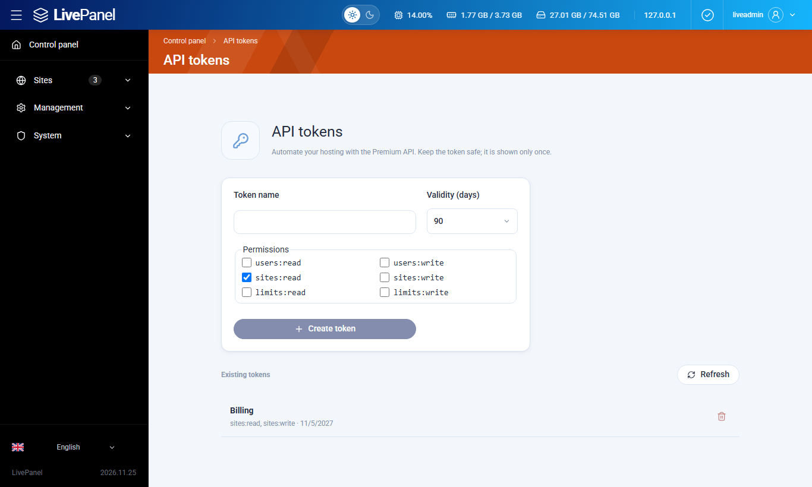
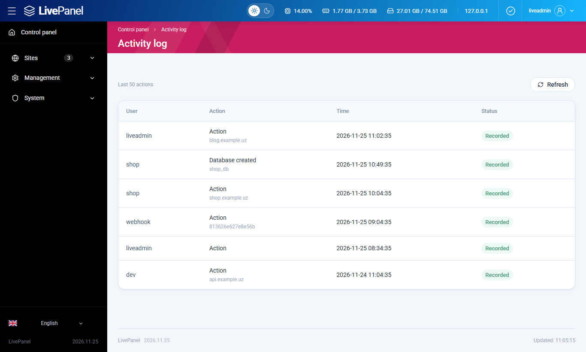

# API tokens and activity log

## API tokens (Premium)

On the **Premium** plan hosting services can be automated through the API: for example, your billing system creates an account and a site for a customer after payment, changes their limits or blocks them when the term ends.

### Creating a token

1. Open **System → API tokens**.
2. **Token name** — e.g. “Billing”.
3. **Valid for (days)**.
4. **Permissions** — the token can do only the selected actions:

   | Permission | What it does |
   |---|---|
   | `users:read` / `users:write` | View / create and change accounts |
   | `sites:read` / `sites:write` | View / create and change sites |
   | `limits:read` / `limits:write` | View / change limits |

5. Click **Create token**. **Copy the token right away** — it is shown only once.

Requests send the token in the `Authorization: Bearer <token>` header. In the **Existing tokens** list you **revoke** a token you no longer need — it stops working immediately.

> Create tokens with the fewest permissions needed and keep them secret: a token is as powerful as a panel password.

## Activity log

**System → Activity log** shows who did what in the panel and when: creating and deleting sites, databases, file uploads, backups, Git deploys, firewall changes, sign-ins and more. Each entry has the user (or `webhook`), the action and the time.

An administrator sees the actions of all accounts, a reseller those of their own users. When something changed on a site and nobody knows why, or you need to know who deleted a file — look here first.
