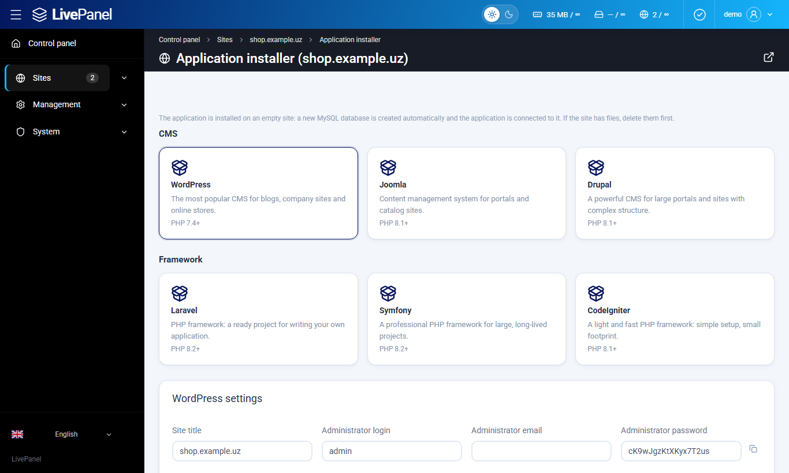

# Installing CMS and frameworks

The panel installs popular CMS and frameworks in one click: it downloads them, creates a database when needed, configures and starts them. You can install an application in two places:

- **Site creation wizard → CMS / Framework** — the site and the application are created together ([Creating a site](create-site.md));
- the **Application installer** tile of an existing empty site.

## Applications

| Platform | CMS | Frameworks |
|---|---|---|
| **PHP** | WordPress (PHP 7.4+), Joomla (8.1+), Drupal (8.1+) | Laravel (8.2+), Symfony (8.2+), CodeIgniter (8.1+) |
| **Node.js** | Strapi (Node.js 20+), Ghost (22+) | Express (18+), Next.js (20+), NestJS (20+) |
| **Python** | Wagtail (Python 3.11+) | Django, Flask, FastAPI (3.11+) |

The application must match the site type: a PHP application on a PHP site, a Node.js application on a Node.js site, and so on. If the site’s PHP/Node.js/Python version is too old, the panel warns you — raise the version in the [site settings](site-settings.md).

## Installing

1. The site must be **empty** (only the panel’s starter page). If it has files, delete them first or create a new site.
2. Open the **Application installer** tile and choose the application.
3. For applications with an administrator (WordPress, Joomla, Drupal, Wagtail, Django) fill in:
   - the **Site name**;
   - the **Administrator login**, **email** and **password** (at least 12 characters; the panel suggests one).
4. Click **Install …**.

The progress is shown step by step (database, download, configuration, installation, start). It can take a few minutes; the installation continues even if you close the page.

## The result

When the installation finishes you get:

- the site address and a link to the **admin panel** (e.g. `/wp-admin/` for WordPress, `/admin/` for Django and Wagtail, `/docs` for FastAPI);
- the created **database name, user and password** — save them.

On an error the reason and the process log are shown; the site is returned to its starting state and you can try again with **New installation**.

## By platform

- **PHP CMS** — the files go into the site folder and are connected to a new MySQL database. WordPress is installed with WP-CLI.
- **PHP frameworks** — the project is created with Composer; the site’s web root becomes the project’s `public/` folder.
- **Node.js** — the project is created in the site folder, built when needed (`npm run build`) and started by the site service. Strapi and Ghost get a MySQL database.
- **Python** — the project is created in the site folder, packages go into the site’s `.venv` and Gunicorn runs it. Django and Wagtail keep their data in an SQLite file; static files are served by WhiteNoise.

How to manage Python and Node.js projects afterwards — [Python and Node.js sites](python-nodejs.md).
