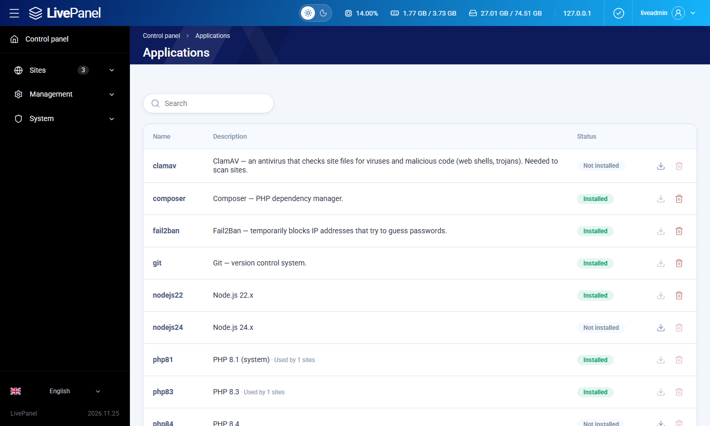

# Applications (server software)

**System → Applications** (for an administrator) is where extra software is installed on and removed from the server. Each installation runs in the background; its status is shown in the list.

## What is available

| Group | Applications |
|---|---|
| PHP | PHP 5.6 – 8.6 (each version with FPM, CGI, CLI and the common extensions). the system version is PHP 8.1 on Ubuntu 22.04 and PHP 8.3 on Ubuntu 24.04 |
| Node.js | Node.js 16 – 26 (official nodejs.org builds, checked by sha256) |
| Python | Python 3.11 – 3.15 (python-build-standalone, checked by sha256) |
| Services | Redis, Memcached, fail2ban, BIND (DNS), SpamAssassin, ClamAV, Roundcube webmail |
| Databases | PostgreSQL, phpMyAdmin (system part) |
| Tools | Git, Composer, WP-CLI, jpegoptim, optipng, AWStats, ttyd |

## Installing and removing

- The **Install** icon installs the application. It can take a few minutes; the status goes from **Installing** to **Installed**.
- The **Remove** icon removes it.
- System parts (e.g. the system PHP, phpMyAdmin) cannot be removed.
- A version used by sites cannot be removed — the list says “used by N sites”. Move the sites to another version first.
- On an error the status becomes **Error** and the reason is shown.

## What you need for what

| Task | Install |
|---|---|
| Create a Python site | Python 3.x |
| Move a site to a newer PHP | PHP 8.x |
| Scan sites for viruses | ClamAV |
| Protect SSH, FTP and mail from password guessing | fail2ban |
| Make this server a DNS server | BIND |
| Open mail in the browser | Roundcube |
| PostgreSQL databases | PostgreSQL |
| Caching (WordPress, Laravel) | Redis or Memcached |
