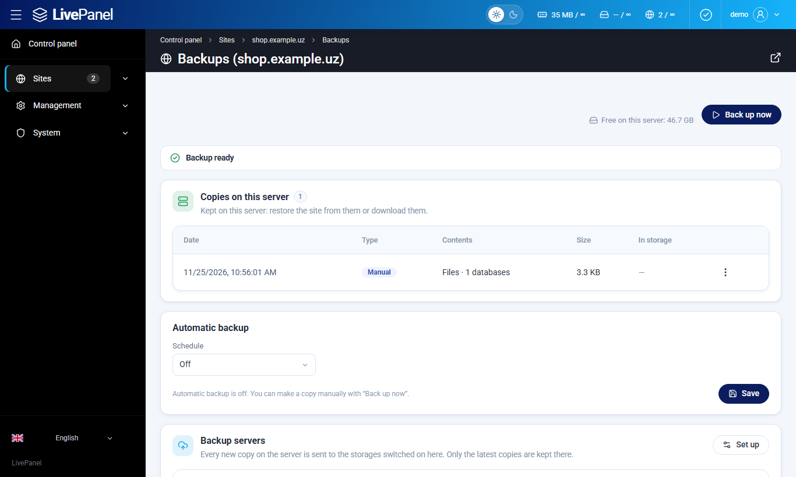
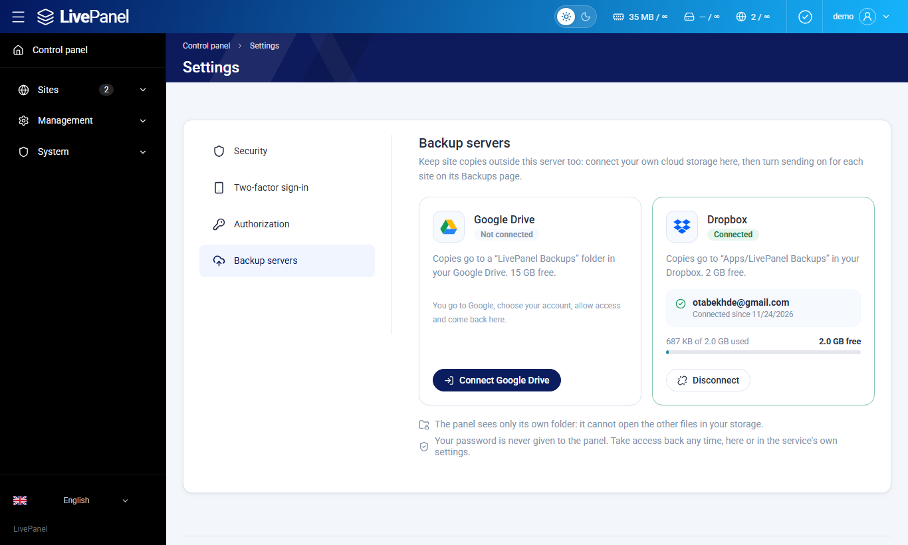

# Backups

The panel backs up a site’s files and databases, makes copies on a schedule, restores them in one click and also sends them to **Google Drive** or **Dropbox**.

Open it with the **Backups** tile on the site page. The top shows the free space on the server and the **Back up now** button.

## Copies on the server

Each copy shows its date, type (**Manual**, **Automatic** or **From storage**), contents (files, number of databases), size and which storages it was sent to. The row menu has:

- **Download** — save the copy to your computer as a `.tar` archive;
- **Restore** — return the site to the state of this copy;
- **Delete** — the copy is removed from the server (copies in storages are not deleted).

### Restoring

1. Choose **Restore** in the copy’s menu.
2. Select what to restore: **Files** and/or **Databases**.
3. Confirm.

> When files are restored, the site folder is replaced completely — the current files are deleted. Databases return to their state in the copy.

## Automatic backup

In the **Automatic backup** section:

- **Schedule** — **Off**, **Daily** or **Weekly** (with the weekday);
- **Time (server)** — by the server clock;
- **Copies to keep** — older automatic copies are removed by themselves (manual copies and copies from storage are not);
- what to back up: **Files** and **Databases**.

The result of the last automatic backup is shown here.

## Backup servers (Google Drive, Dropbox)

A copy outside the server lets you restore the site even if the server is lost.

### 1. Connect a storage

In **Settings → Backup servers**:

- **Connect Google Drive** — a Google page opens; choose the account and allow access. In the Google dialog tick **See, edit, create and delete only the specific Google Drive files you use with this app** — otherwise the connection is refused.
- **Connect Dropbox** — click **Allow** on the Dropbox page.

The panel sees only the folder it created (“LivePanel Backups” in Google Drive, “Apps/LivePanel Backups” in Dropbox) — it cannot reach your other files. Your password is never given to the panel. Every user connects their own storage; the card shows the used and free space in it.

### 2. Turn sending on for the site

On the site’s **Backups** page, in the **Backup servers** section:

1. Turn on the switch in the storage row.
2. Set the number of **copies kept in the storage** (1–60).
3. **Send now** — sends an existing copy right away.

From then on every new copy on the server is sent to the storage by itself within a few minutes. Older copies beyond the set number are removed from the storage.

> “Send now” does not make a new copy; it only sends the copies on the server. If there are none, click **Back up now** first.

### 3. Restoring from a storage

The **Copies in storage** table shows each copy’s state: **Also on this server**, **Only in storage** or **From another server**. For a copy that is only in the storage, **Get to server** brings it back to the server — then restore it as usual. This is also how you **move a site to another server**: connect the same storage on the new server and get the copy.
