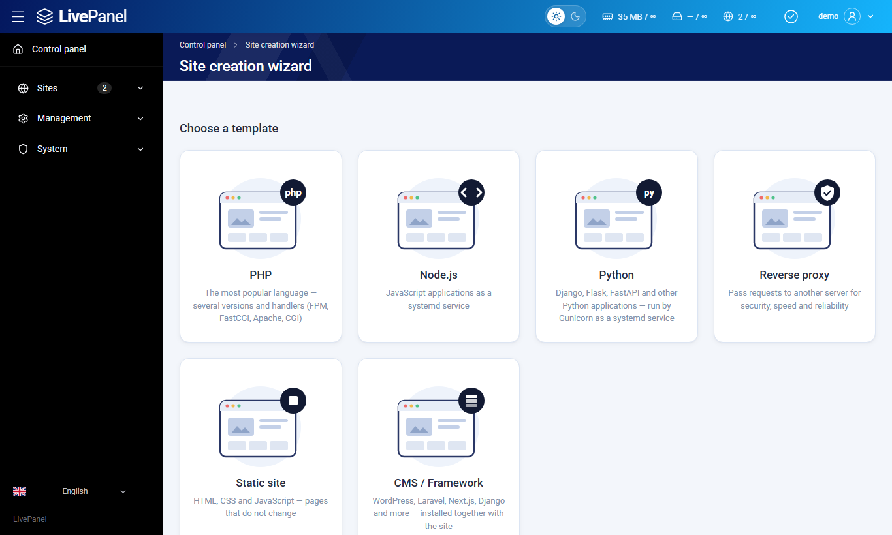
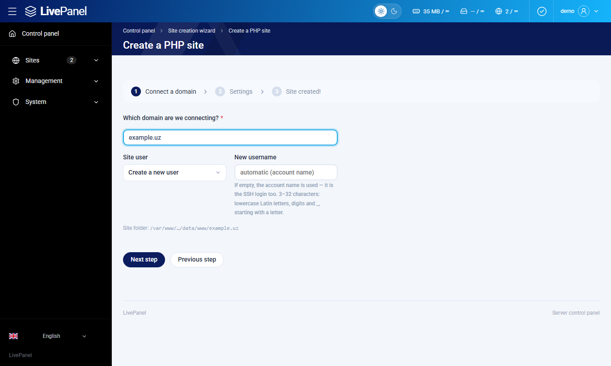
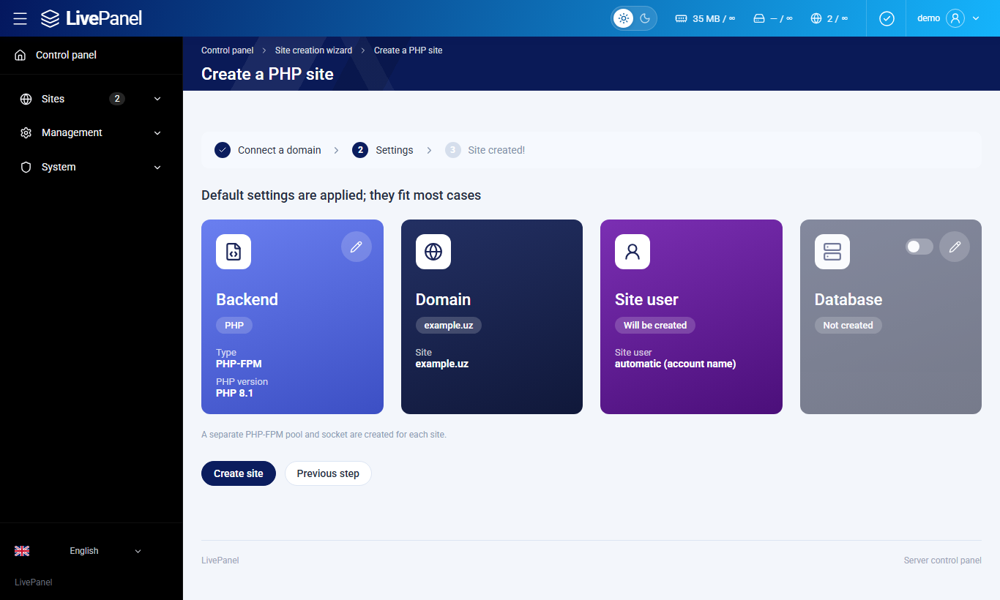

# Creating a site

A site is created in three steps of the **Site creation wizard**: template → domain → settings. The **Create site** button on the **Sites** page opens it.

> The domain must point to the server, before or after the site is created: at your domain registrar or DNS provider set the domain’s **A record to the server’s IP address**. This server can also be the DNS server — [Domains and DNS](dns.md).

## Step 1: choose a template

| Template | When to choose it |
|---|---|
| **PHP** | WordPress, Laravel and other PHP sites. Several PHP versions and handlers (PHP-FPM, FastCGI, Apache, CGI) |
| **Node.js** | Express, Next.js, NestJS and other JavaScript applications — run as a systemd service |
| **Python** | Django, Flask, FastAPI and other Python applications — run by Gunicorn |
| **Reverse proxy** | Pass requests to another address (an application in a Docker container or another server) |
| **Static site** | HTML, CSS and JavaScript files only |
| **CMS / Framework** | A ready application installed together with the site |

### CMS / Framework

Here you pick the platform (PHP, Node.js, Python), then the kind (**CMS** or **Framework**) and the application. After the site is created the application is downloaded and installed automatically — see [Installing CMS and frameworks](app-installer.md).

## Step 2: connect a domain

- **Which domain are we connecting?** — the site’s domain, e.g. `example.uz`. `www.example.uz` is added as an alias automatically.
- **Site user** — the Linux user the site runs under:
  - **Create a new user** — recommended for every new site; sites stay isolated from each other.
  - **An existing user** — the site shares the user of an earlier site (when they need shared file access).
- **New username** — if empty, the account name is used; it is the SSH login too. 3–32 characters: lowercase Latin letters, digits and `_`, starting with a letter.
- An administrator or reseller can create the site for another account.

**Subdomains.** If you enter a subdomain such as `blog.example.uz` and `example.uz` is in the panel, the new site joins that site’s user automatically.

The site folder is shown below: `/var/www/<user>/data/www/<domain>`. That folder itself is the site’s entry point.

## Step 3: settings

The defaults suit most cases. Change them with the pencil on a card:

- **Backend** — the PHP version and handler, the Node.js or Python version, the proxy address.
- **Domain** and **Site user** — your choice from step 2.
- **Database** — turn it on to create a MySQL or PostgreSQL database with the site. It belongs to the site: deleting the site deletes the database too.

Click **Create site**. In a few seconds the site is up with a starter page in its folder — replace it with your own files.

## After creating the site

1. [Get an SSL certificate](ssl.md) — a free Let’s Encrypt certificate in one click.
2. Upload files with the [file manager](file-manager.md), [FTP/SFTP](ftp-ssh.md) or [Git](git-deploy.md).
3. Create a [database](databases.md) and [mail](mail.md) if needed.
4. Turn on [automatic backups](backups.md).

> A Python site needs a Python version installed on the server first (**System → Applications**). If none is installed, the wizard says so and the Create site button stays disabled.
