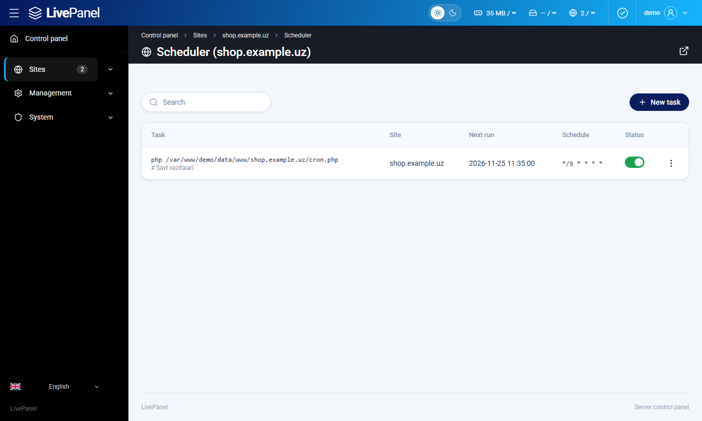

# Scheduler (cron)

The scheduler runs commands on a schedule: for example the site’s `cron.php` every 5 minutes, a daily report or a cache cleanup.



Open the **Scheduler** tile on the site page. The table shows each task’s command, site, **next run**, schedule and status.

## Adding a task

1. Click **New task**.
2. **Site** — the task runs as this site’s user.
3. **Schedule** — pick a preset: **Every minute**, **Hourly**, **Daily**, **Weekly**, **Monthly** or **Custom**. In Custom you set the minute, hour, day, month and weekday; the resulting **cron expression** is shown below (e.g. `*/5 * * * *`).
4. **Command** — what to run. Use full paths:

   ```bash
   php /var/www/shop/data/www/shop.example.uz/cron.php
   ```

   For PHP sites use a path such as `/usr/bin/php8.3` to pin the site’s PHP version.
5. **Comment** — a note on what the task is for.
6. Save.

## Managing tasks

- The **on/off** switch pauses a task without deleting it.
- **Run now** runs the command immediately and shows the result: exit code, run time and the output. Useful for testing.
- **Edit** and **Delete**.

## Tips

- Laravel: `php /var/www/<user>/data/www/<domain>/artisan schedule:run` — every minute.
- WordPress: first add `define('DISABLE_WP_CRON', true);` to `wp-config.php`, then run `php .../wp-cron.php` every 5 minutes.
- The output of scheduled runs is not kept; to log it, redirect it to a file: `... >> /var/www/<user>/data/cron.log 2>&1`.
