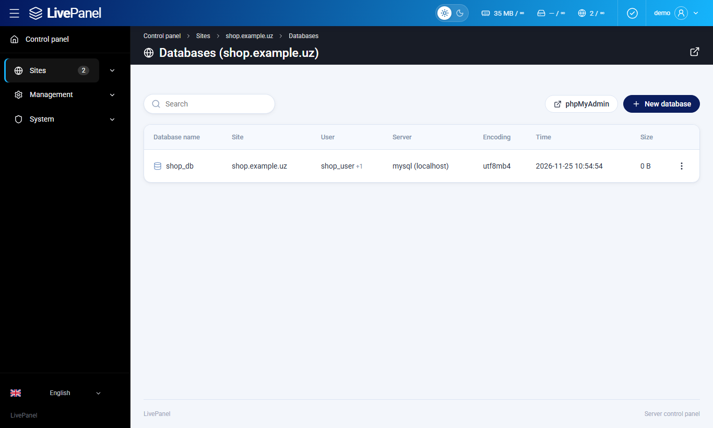
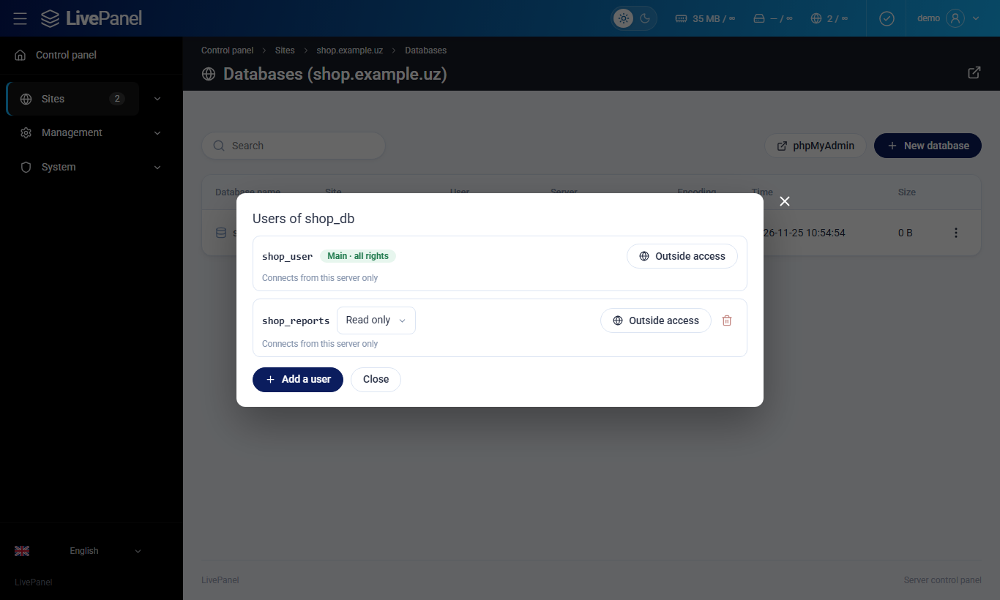

# Databases

The panel manages **MySQL 8** databases (installed with the panel) and **PostgreSQL** databases (installed from **System → Applications**). Every database belongs to one site: when the site is deleted, its databases are deleted too.

## Creating a database

1. On the **Databases** page click **New database**.
2. **Database type** — MySQL or PostgreSQL.
3. **Site** — which site the database belongs to.
4. **Database name** and **User** — lowercase Latin letters, digits and `_`, up to 32 characters.
5. **Password** — at least 8 characters; the **Generate** button makes a strong one. **Save the password** — it is not shown again.
6. **Charset** — `utf8mb4` (recommended).

Settings for your site:

| | MySQL | PostgreSQL |
|---|---|---|
| Host | `localhost` | `127.0.0.1` |
| Port | 3306 | 5432 |

## phpMyAdmin and Adminer

**Open phpMyAdmin** in the row menu (**Open in PostgreSQL** for PostgreSQL) opens the database in one click without asking for a password — the panel creates a temporary sign-in.

## The row menu

| Action | Notes |
|---|---|
| Change password | A new password for the main user |
| Users and access | Extra users and outside access (MySQL) |
| Import (.sql) | Load a dump file into the database |
| Export (.sql.gz) | Download the database as a compressed dump |
| Delete | The database and all its data are deleted |

## Extra users and rights

The **Users and access** dialog shows the database’s main user (all rights) and the extra users. Up to 20 users can be added to one database.

| Right | What the user can do |
|---|---|
| **All rights** | May also create, change and drop tables |
| **Read and write** | Reads, adds, changes and deletes data; cannot change the table structure |
| **Read only** | Reads only — for reports and backup tools |

## Outside access (Remote MySQL)

Normally the database accepts connections only from this server. If you need to connect from a program on your computer (DBeaver, HeidiSQL, MySQL Workbench) or from another server:

1. In the user row click **Outside access**.
2. **Addresses allowed to connect** — one IP (`203.0.113.7`) or network (`198.51.100.0/24`) per line. `%` means any address (risky: the database is open to the whole internet).
3. When a new address is added, a **password** is asked — it becomes the user’s password everywhere.
4. Save. Connect with the server IP as the host, port 3306.

The panel opens MySQL to outside addresses and **opens port 3306 in the firewall only for the listed addresses**. When the list is emptied, the port is closed again.

## Import

1. Choose **Import (.sql)** and pick a `.sql` or `.sql.gz` file.
2. The file is uploaded (the percentage is shown), then written into the database.
3. On an error the MySQL/PostgreSQL message is shown.

Security: the import runs as a temporary user with rights to this database only — the commands in the file cannot touch other databases. `DEFINER` clauses from dumps of other servers are removed, and views and triggers are moved to the database’s own user. Large files can be imported too (up to 2 GB).

## Limits

If the account has a database limit, no new database is created once it is reached — [Users, roles and limits](users.md).
