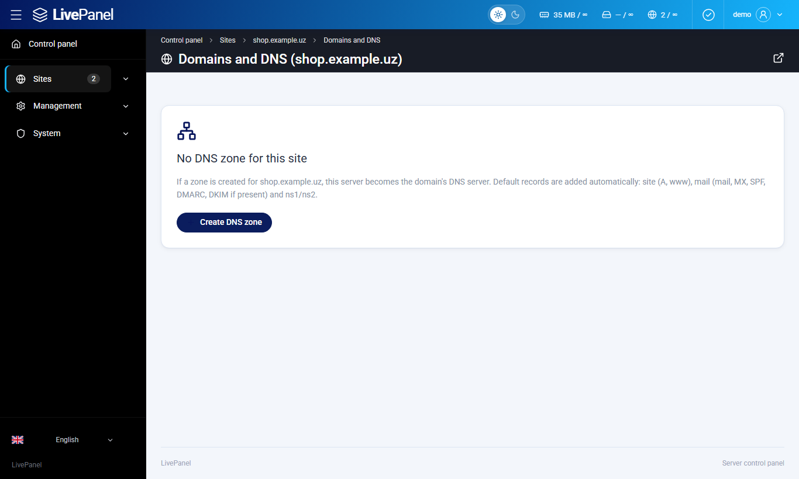

# Domains and DNS

For a site to open, its domain must point to the server’s IP address. There are two ways:

1. **At your domain registrar or an external DNS provider** (e.g. Cloudflare) add an A record — the simplest way.
2. **Make this server the domain’s DNS server** — a DNS zone is created in the panel and you manage all records from it.

## Way 1: an A record

In your registrar’s DNS settings add:

| Name | Type | Value |
|---|---|---|
| `@` | A | the server IP address |
| `www` | A | the server IP address |

For mail you also need MX, SPF, DKIM and DMARC records — the **Mail** section shows them: [Mail](mail.md).

## Way 2: a DNS zone in the panel

The DNS server (BIND) must be installed — **System → Applications** → `bind9`.

1. Open the **Domains and DNS** tile on the site page.
2. Click **Create DNS zone**. Default records are added automatically:
   - `A` for the site (`@` and `www`);
   - `mail`, `MX`, `SPF`, `DMARC` for mail (and `DKIM` if mail is on);
   - `ns1` and `ns2`.
3. At your domain registrar set the domain’s **NS servers** to `ns1.<domain>` and `ns2.<domain>` and enter the server IP as their address (**glue record**). The panel shows the exact values on the page.
4. NS changes take a few hours up to 48 hours to spread. Check with `dig NS example.uz`.

## Managing records

**Add record**, and edit or delete from the row menu. Each record has a **Name**, **Type**, **Value**, **TTL** and, where needed, **Priority**.

| Type | Purpose |
|---|---|
| A | Name → IPv4 address. `@` is the domain itself, `www` is www.domain |
| AAAA | Name → IPv6 address |
| CNAME | The name is an alias of another name. Not allowed on the domain itself (`@`); a trailing dot means a full name |
| MX | Mail server; the lower priority number is tried first |
| TXT | SPF, DKIM, DMARC, domain verification codes |
| NS | DNS servers of the domain or a subdomain |
| SRV | Service location: `weight port target` |
| CAA | Which authorities may issue SSL, e.g. `0 issue "letsencrypt.org"` |

The zone **serial number** grows on every save. **Delete zone** removes the zone completely — if the domain uses this server through NS, it stops opening.
