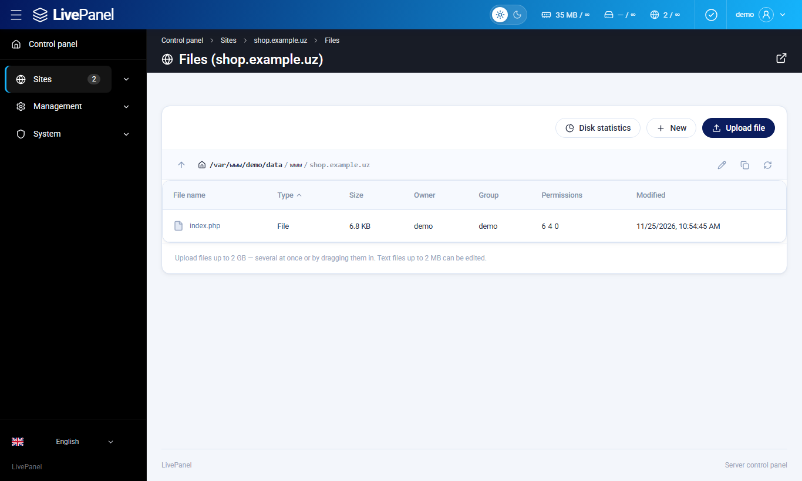

# File manager

The file manager lets you work with the site files in the browser: upload, edit, archive and more. Open it with the **Files** tile on the site page. The account needs the **Manage files** permission.

It shows the site user’s home folder and never goes outside it. The site files are in `www/<domain>`. Every action runs as the site user, so file owners stay right and the disk quota is counted.

## Uploading

- The **Upload file** button, or **drag** files into the window.
- One file can be up to 2 GB. Several files can be uploaded at once.
- With several files, **one progress bar for their total size** is shown, e.g. “Uploading 20 files — 7 done · 45%”. Files that failed are listed with the reason.
- Folders cannot be uploaded — upload an archive and extract it in the panel.

## New file and folder

**New** creates an empty file or folder.

## Actions

Double-click a file to open or edit it. With the row menu or by selecting several items:

| Action | Notes |
|---|---|
| Open / Edit | Text files up to 2 MB, with syntax highlighting; the encoding can be chosen |
| Download | Save to your computer |
| Rename | |
| Move, Copy | To another folder |
| Change permissions | E.g. `644` (file), `755` (folder); recursive with “Apply to contents too” |
| Add to archive | A `.zip` or `.tar.gz` archive |
| Extract | ZIP, TAR, GZ, RAR, 7Z and more |
| Delete | Folders are deleted with their contents |

With several items selected, move, copy, permissions, archive and delete apply to all of them.

## About deleting

- Any file or folder can be deleted; read-only folders are deleted with their contents too.
- If the site’s own folder or `www` is deleted, the panel **makes it again, empty** — the site keeps working.
- These folders cannot be moved or renamed, because the site lives at that path.

## Disk statistics

**Disk statistics** shows what takes the space in a folder: the largest folders, the largest files and the size by extension. Useful when the disk fills up.

## Security

Symbolic links cannot lead outside the site user’s folder — other sites and system files stay invisible.
