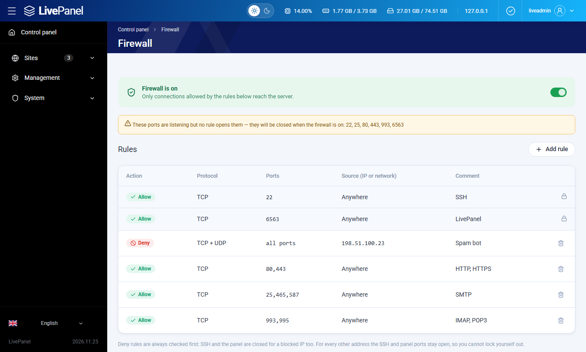

# Firewall

**System → Firewall** (for an administrator) sets which ports of the server can be reached and from where. The panel manages nftables rules.

## Turning it on

The firewall is off at first — the server is open on all ports. With the switch at the top on, only connections allowed by the rules reach the server.

The panel warns about:
- **ports that are listening but no rule opens** — they are closed when the firewall is on;
- **ufw** also being active on the server — both firewalls work together, and a connection gets through only if both allow it.

## Rules

Each rule has:

| Field | Value |
|---|---|
| **Action** | **Allow** or **Deny** |
| **Protocol** | TCP, UDP or both |
| **Ports** | one (`8080`), a list (`80,443`) or a range (`3000-3010`); empty means all ports |
| **Source** | an IP or network (`198.51.100.0/24`); empty means anywhere |
| **Comment** | what the rule is for |

Default rules: HTTP/HTTPS (80, 443) and, when installed, FTP, SMTP, IMAP/POP3.

- **Deny** rules are always checked first. A deny rule needs a source; without ports the source is blocked completely.
- The rules for **SSH and the panel port** are system rules and cannot be removed, so you cannot lock yourself out of the server.
- When outside access to a database is on, a system rule for port 3306 and the listed addresses is added automatically — [Databases](databases.md).

## Saving and safety

**Save and apply** applies the rules immediately. If after applying the panel cannot confirm the connection with your browser within a minute (for example, you blocked yourself), **the previous rules are restored automatically**.

The rules survive a server reboot.

> Your provider may also have an external firewall (in its cloud panel) — the panel’s rules work behind it.
