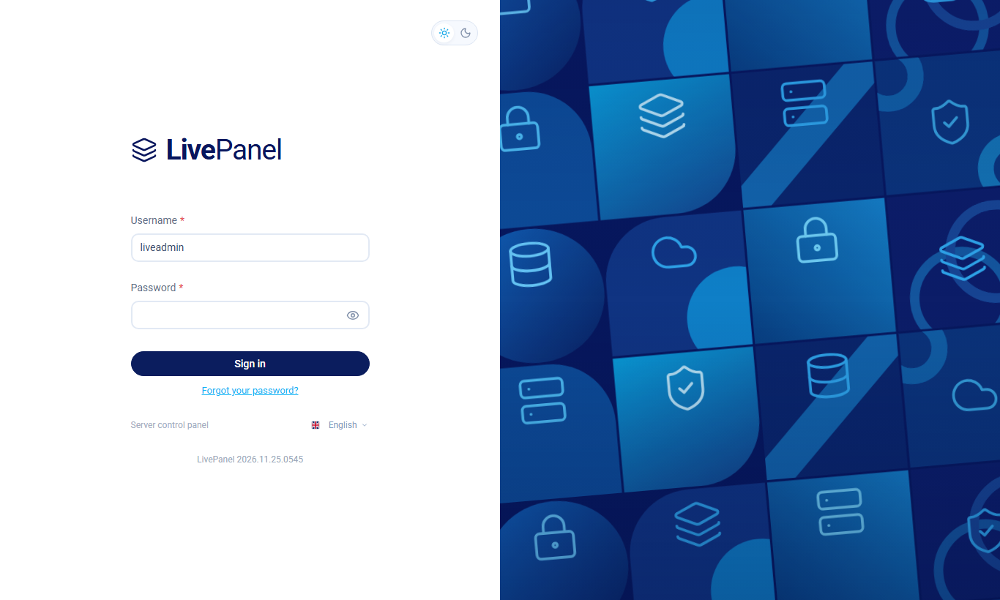
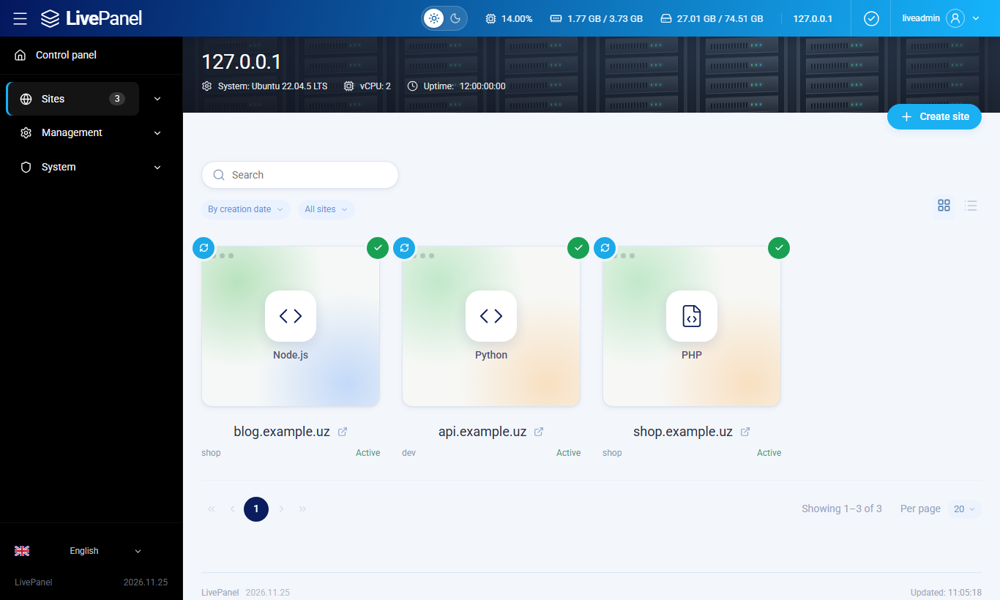
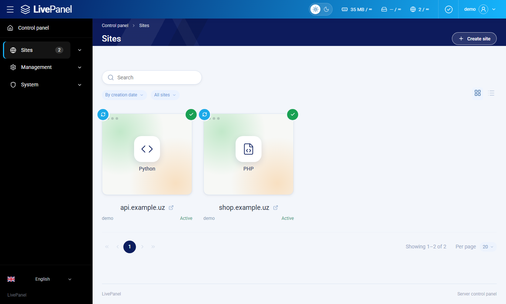

# First sign-in and the interface

## The sign-in page

Enter the login and password at `https://SERVER_IP:6563`. The menu at the bottom right selects the panel language, the button at the top switches between the light and dark look.

- **Forgot your password?** — if the account has a recovery email, a link to set a new password is sent there (valid for 30 minutes).
- After several wrong passwords the IP address is blocked for a while — [Panel settings and security](panel-settings.md).
- With two-factor sign-in (2FA) on, a 6-digit code from the authenticator app is asked after the password.

## After the first sign-in

1. **Activate a license** — the panel does not work without one; the Free plan costs nothing. [License and plans](license.md).
2. **Enter a recovery email** — the panel asks for it on the first sign-in. You use it if you forget the password.
3. **Change the password** and **turn on 2FA** — **Settings → Security** and **Two-factor sign-in**.

## The panel layout

**Top bar:**
- CPU, memory and disk use and the server IP address (for an administrator);
- for a regular user, their limits: RAM and disk used and the number of sites;
- the light/dark switch and the account menu (settings, sign out).

**Left menu:**

| Section | Contents |
|---|---|
| **Control panel** | Server status and site cards |
| **Sites** | The list of sites, a new site, the sections of each site |
| **Management** | Files, databases, SSL, DNS, mail, FTP, cron, backups |
| **System** | Users, applications, services, firewall, statistics, terminal, activity log, license |

The menu depends on the account role: a regular user does not see server settings — [Users, roles and limits](users.md).

## The Sites page

Each site card shows the site’s look (a screenshot), its domain, owner and status. Click the card to open the site page — [Managing a site](site-management.md). The **Create site** button at the top right opens the site creation wizard — [Creating a site](create-site.md).

You can switch between cards and a table, search and sort the sites.
