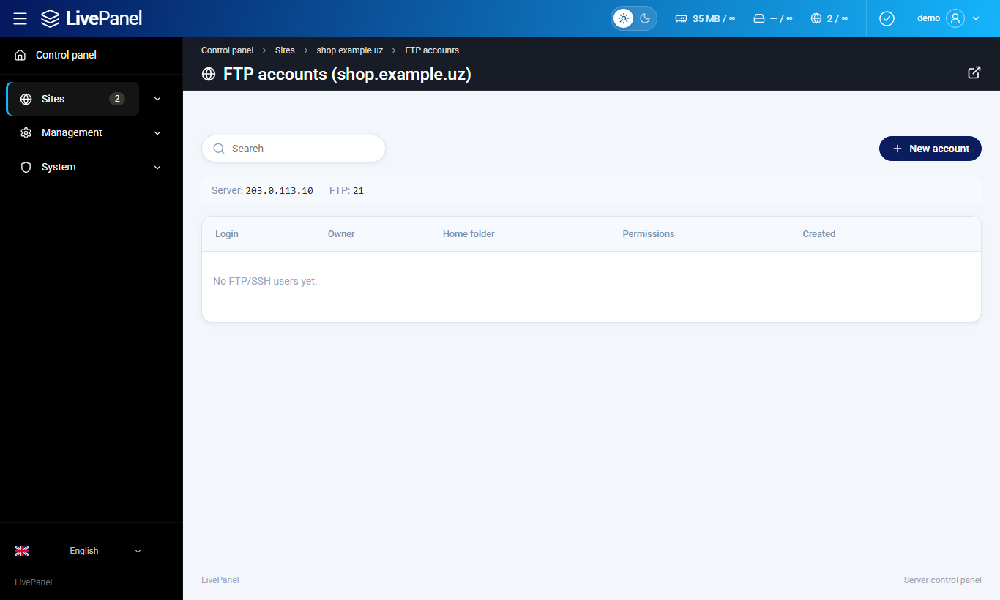

# FTP, SFTP and SSH

To upload files with FileZilla, WinSCP and similar programs, create an FTP account. For the command line, use SSH.

## FTP accounts



Open the **FTP accounts** tile on the site page. The top of the page shows the connection details: the server address and the FTP port (21).

### Creating an account

1. Click **New account**.
2. **Login** — lowercase Latin letters, digits, `_` and `-`; starts with a letter (3–32 characters).
3. **Site** — the account works as this site’s owner.
4. **Home folder** — the account sees only this folder. It must be the site folder or a folder inside it.
5. **Permissions** — **Full access** or **Read only**.
6. Enter or generate a password and save.

Later you can edit the account, change its password, turn it off for a while or delete it. Deleting an account does not delete the site files.

### Connecting

| | Value |
|---|---|
| Host | the server IP address or domain |
| Protocol | FTP (port 21, passive mode) |
| Login / password | the account you created |

Files uploaded over FTP belong to the site owner — the site reads them without trouble.

## SFTP and SSH

SSH is given to a panel account: the administrator turns on **Allow SSH access** in the account settings under **System → Users**. Then:

- **Login** — the Linux user of the account’s sites (the user list shows it as the SSH login);
- **Password** — the same as the panel password;
- **Port** — the server’s SSH port (usually 22).

```bash
ssh shop@SERVER_IP
```

For SFTP choose the **SFTP** protocol in FileZilla or WinSCP; the same login and password work.

> An SSH user works in an isolated environment: they see only their own home folder and cannot leave it. For server-wide work an administrator uses the [Terminal](terminal.md) in the panel as root.

Many wrong passwords are blocked by fail2ban — [Panel settings and security](panel-settings.md).
