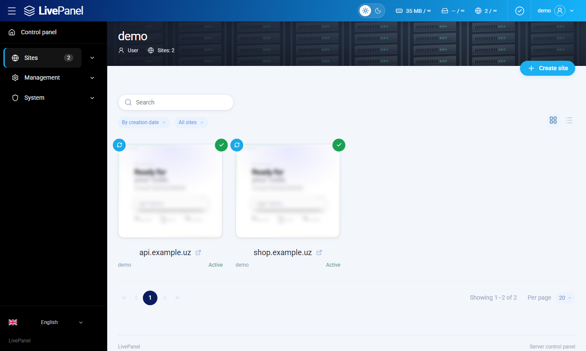

# What is LivePanel

**LivePanel** is a hosting control panel for managing a Linux server and its websites from the browser. It is installed on the server and brings sites, databases, mail, SSL certificates, backups and the server itself together in one place — no command line needed.

> The pictures show the panel in English. Switch the panel language at any time in the menu at the bottom left (Uzbek, Russian or English).

## What the panel can do

| Area | Features |
|---|---|
| Sites | PHP (5.6–8.6), Node.js, Python, static sites and reverse proxy; a site creation wizard; subdomains; switching the backend type later |
| Applications | WordPress, Joomla, Drupal, Laravel, Symfony, CodeIgniter, Strapi, Ghost, Express, Next.js, NestJS, Wagtail, Django, Flask, FastAPI — in one click |
| Development | Git deploy (automatic with a webhook), environment variables, site services and logs, a web terminal |
| Data | MySQL 8 and PostgreSQL, password-less phpMyAdmin and Adminer, import/export, extra users and outside access |
| Security | Free Let’s Encrypt SSL, firewall, sign-in protection and fail2ban, two-factor sign-in (2FA), closing a site by IP, ClamAV antivirus |
| Mail | Mail domains, mailboxes, forwards, DKIM, Roundcube webmail |
| Backups | Scheduled backups, one-click restore, copies sent to Google Drive and Dropbox |
| Administration | Users and resellers, disk/RAM/domain limits, statistics and traffic, branding, API, automatic updates |

## Who it is for

- **Developers and companies with their own server** — install the panel on a VPS and manage the sites yourself.
- **Hosting providers** — give customers separate accounts with limits and your own brand (resellers).
- **Agencies** — every client site runs under its own Linux user, isolated from the others.

## How it works

- On the server the panel has two parts: the web interface (port 6563) and an agent with root rights. The agent works only through a socket inside the server and is not reachable from outside.
- Every site runs **under its own Linux user**: its PHP-FPM pool, Node.js/Python service, cron tasks and files belong to that user. If one site is compromised, the others are not affected.
- The web server is **Nginx**. PHP runs through PHP-FPM (or FastCGI, Apache, CGI); Node.js and Python applications run as systemd services.
- The panel license is issued at livepanel.uz. The **Free** plan is free of charge and has no expiry.

## Next steps

1. [Installation](installation.md) — install on a server with one command.
2. [First sign-in and the interface](first-login.md) — get to know the panel.
3. [Creating a site](create-site.md) — launch your first site.
