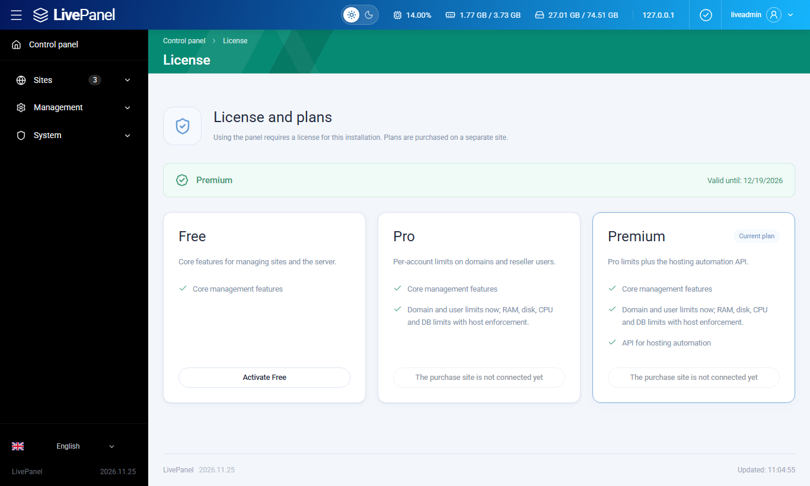

# License and plans

The panel needs a license for this installation. Licenses are issued at livepanel.uz and are **bound to the server’s IP address**.

## Plans

| | Free | Pro | Premium |
|---|---|---|---|
| Price | Free, no expiry | Monthly | Monthly |
| Sites, databases, mail, SSL, backups, Git and all other core features | ✅ | ✅ | ✅ |
| Per-account limits on domains, disk, RAM, databases and reseller users | — | ✅ | ✅ |
| Hosting automation API (tokens) | — | — | ✅ |
| Wildcard SSL certificate (`*.domain`) | — | — | ✅ |

Current prices: [livepanel.uz](https://livepanel.uz) → **Pricing**.

## Activating the Free license

1. In the panel open **System → License**.
2. On the **Free** card click **Activate Free**.
3. A livepanel.uz page opens: sign in (or register) and confirm.
4. The license is sent to the panel automatically — refresh the panel page.

## Buying Pro or Premium

1. On **System → License** click the card of the plan you need.
2. The payment page opens at livepanel.uz with the server address filled in.
3. After payment the license is **installed in the panel automatically** — no key to enter. The panel also picks it up by itself within a few minutes.

You can also see, renew and manage the license in the **Keys** section of your livepanel.uz account.

## How license keys are protected

- **No key to type, no activation code.** A paid license arrives in the panel from livepanel.uz by itself after payment; the panel also asks for it on its own within a few minutes. The button in the panel activates the **Free** plan only.
- **A lower plan never replaces a higher one.** While Premium is active, a Free or Pro key cannot replace it (the panel says “This panel already has a better license”). Within the same plan, the key that runs longer stays.
- **A key goes only to its own server.** livepanel.uz hands a key only to the IP address the license is bound to, or to the server address given at purchase. Knowing the installation ID is not enough to get a key.

## When it expires

- Your account shows a warning 5 days before the end.
- When the term ends the panel features stop for a while, **but the sites keep working**.
- To renew, click **Renew** on the **License** page. After payment **Check again** picks up the new key immediately.

## Moving to another server

A license is bound to one IP address. If you move the panel to another server, **move** the license to it in the **Keys** section of your livepanel.uz account. If the old server has not been in touch for more than 24 hours, the license moves to the new server by itself.

> If the panel says “License is bound to another server”, this is the case: click the move button in your account.
