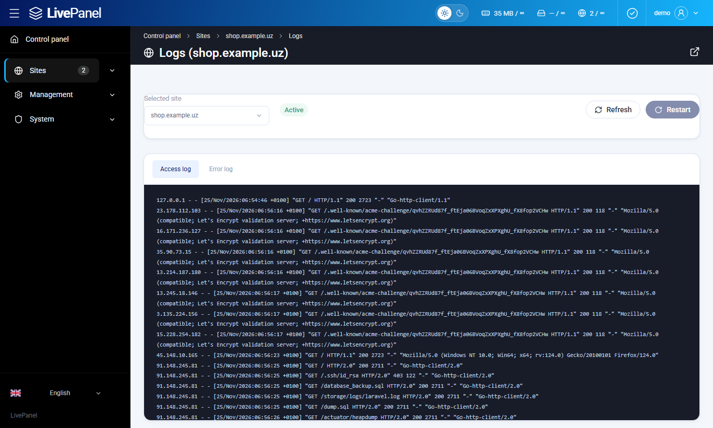

# Logs

Logs show the requests that reach the site and the errors — the first place to look when a site stops working. Open them with the **Logs** tile on the site page (the account needs the **Site services and logs** permission).

## Log types

| Tab | What it shows |
|---|---|
| **Access log** | Every request to the site: IP address, time, page, response code, size, browser |
| **Error log** | Nginx and PHP errors: missing files, permission errors, PHP fatal errors |
| **Application log** | For Node.js and Python sites, the output of the application itself (systemd journal) — start-up errors are here |

The latest entries are shown. **Refresh** loads the log again.

## Restarting the service

The site’s service and its state are shown at the top (e.g. **Active**). The **Restart** button:

- on a PHP site, reloads the site’s PHP-FPM pool;
- on a Node.js or Python site, restarts the application service — press it after changing the code.

## Response codes

| Code | Meaning |
|---|---|
| 200 | The request succeeded |
| 301 / 302 | Redirect |
| 403 | Forbidden — the site is disabled, the IP is blocked or the folder has no index page |
| 404 | File not found |
| 500 | Application error — see the **Error log** or **Application log** |
| 502 | The application is not running or not answering — see the **Application log** |
| 504 | The application took too long to answer |

Logging can be turned off in the site settings — [Site settings](site-settings.md). With the access log off, traffic statistics are not counted.
