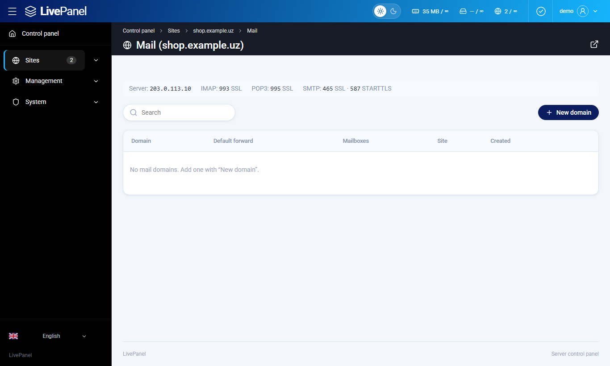

# Mail

The panel sets up a mail server for your domain: mailboxes such as `info@example.uz`, forwards, a DKIM signature so mail does not land in spam, and **Roundcube** webmail for the browser. The mail server (Exim and Dovecot) is installed automatically when the first domain is added — this can take 2–5 minutes.

The top of the page shows the connection details: the server address, IMAP (993, SSL), POP3 (995, SSL), SMTP (465 SSL and 587 STARTTLS).

## 1. Add a mail domain

1. Click **New domain**.
2. **Domain** — mail addresses use this domain (`info@domain`). It can differ from the site name.
3. **Site** — which site the domain belongs to.
4. Save. A DKIM key is created for the domain.

In the domain settings:
- **Default forward** (catch-all) — mail to non-existent addresses goes to this address; if empty, it is rejected;
- the **Mail enabled** switch — when off, the domain accepts no mail.

## 2. Add the DNS records

For mail to arrive and stay out of spam, the domain’s DNS must have these records. The panel shows the exact values in the **DNS records** dialog:

| Record | Purpose |
|---|---|
| `MX` | The domain’s mail comes to this server |
| `A` (`mail`) | The mail server address |
| `TXT` SPF | This server may send mail for the domain |
| `TXT` DKIM | The signature of the messages |
| `TXT` DMARC | What to do with messages that fail SPF/DKIM |

If the DNS zone is on this server, the records are added automatically — [Domains and DNS](dns.md).

## 3. Create a mailbox

1. Choose the domain and click **New mailbox**.
2. **Login** — the part of the address before `@` (`info`).
3. **Password** — a strong password; the panel shows its strength and can generate one.
4. **Aliases** — extra names delivered to this mailbox, one per line (`sales` → `sales@domain`).
5. **Forwards** — a copy of every message is also sent to these addresses (it stays in the mailbox too).
6. **Quota (MB)** — the mailbox size; 0 means unlimited.

A mailbox can be turned off for a while — sign-in and incoming mail stop.

## Setting up mail apps

In Outlook, Thunderbird or a phone mail app:

| | Server | Port | Encryption |
|---|---|---|---|
| Incoming (IMAP) | the server address | 993 | SSL/TLS |
| Incoming (POP3) | the server address | 995 | SSL/TLS |
| Outgoing (SMTP) | the server address | 465 or 587 | SSL/TLS or STARTTLS |

The login is the full address (`info@example.uz`), the password is the mailbox password.

## Webmail

With **Roundcube** installed (**System → Applications** → `roundcube`), you open mail in the browser at `https://SERVER:6563/webmail/`. The **Webmail (Roundcube)** link on the page leads there too.

## If mail is not sent

- Many VPS providers **block outgoing port 25** against spam. The panel warns when it detects this: receiving works, but mail to outside services (Gmail and others) does not leave. Ask your provider to open the port.
- If mail lands in spam, check the SPF, DKIM and DMARC records and that the server’s **PTR (reverse DNS)** record points to `mail.domain` (PTR is set at the provider).
