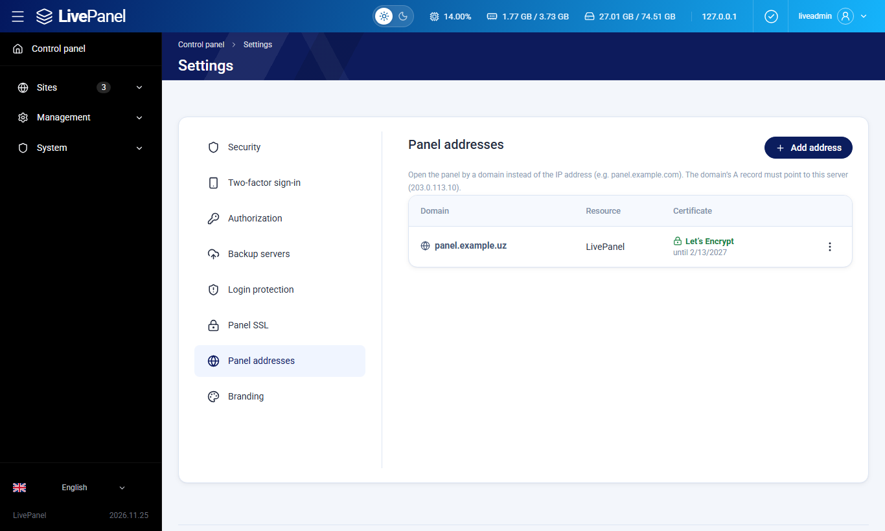
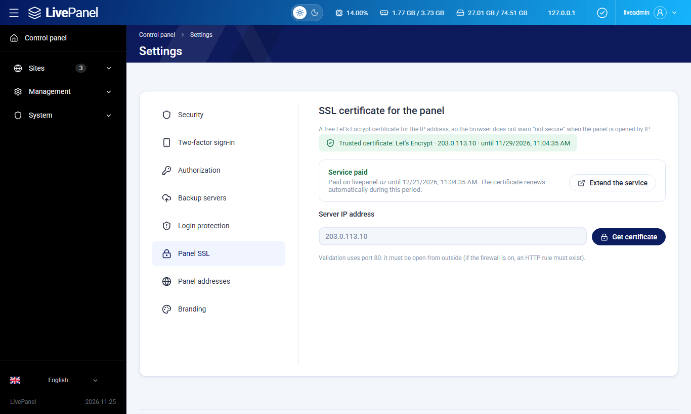

# Panel address and SSL

At first the panel opens at `https://SERVER_IP:6563` with a certificate it made itself (self-signed), and the browser warns that it is “not secure”. There are two ways to fix this.

## 1. Panel addresses: open the panel by a domain

**Settings → Panel addresses** (for an administrator) — open the panel by a domain instead of the IP, e.g. `https://panel.example.uz`.

1. Point the domain’s **A record** to the server IP address.
2. Click **Add address** and enter the domain.
3. **Certificate type**:
   - **Let’s Encrypt** — a free trusted certificate, renewed automatically;
   - **Self-signed**;
   - **Existing certificate** — paste your own certificate and private key (PEM).
4. Save. The panel now opens at `https://panel.example.uz` (no port needed).

If Let’s Encrypt cannot issue the certificate, a self-signed one is used for now and the reason is shown.

### Access by IP

Turn off the **Access by IP** switch under the address table and port 6563 is closed to the outside: the panel opens only through its addresses. Access from the server itself (`127.0.0.1`) stays open.

- The switch works once an address with a Let’s Encrypt or your own certificate is added.
- To turn it off, open the panel through its address (e.g. `https://panel.example.uz`) — on a page opened by IP the switch is inactive.
- When no such address is left (removed, or its certificate replaced by a self-signed one), access by IP turns back on by itself.
- If the address stops working, on the server over SSH: `livepanel ip-access on` — [Server commands](console.md).

## 2. Panel SSL: a certificate for the IP address

**Settings → Panel SSL** — the panel opens by its IP address with a trusted certificate even without a domain. The certificate is issued by Let’s Encrypt for the IP address.

- This is a paid livepanel.uz service (monthly). The **Buy at livepanel.uz** button opens the payment page.
- After payment click **Get certificate** — the panel switches to the new certificate within 30 seconds.
- IP certificates are short-lived (~6 days): while the service is paid, the panel renews them itself. If the service ends, the panel returns to its own certificate and keeps working.
- Validation uses port 80 — it must be open from outside.

## The panel port

The panel works on port 6563. This port must be open in your provider’s external firewall. With panel addresses, the panel also opens through port 443; with **Access by IP** off, it opens only this way.
