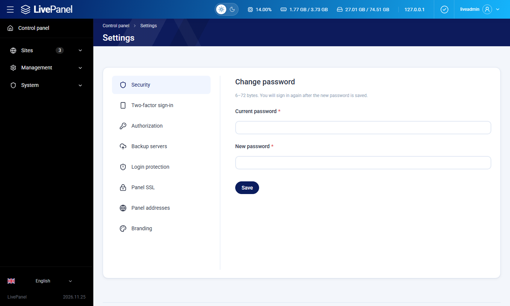
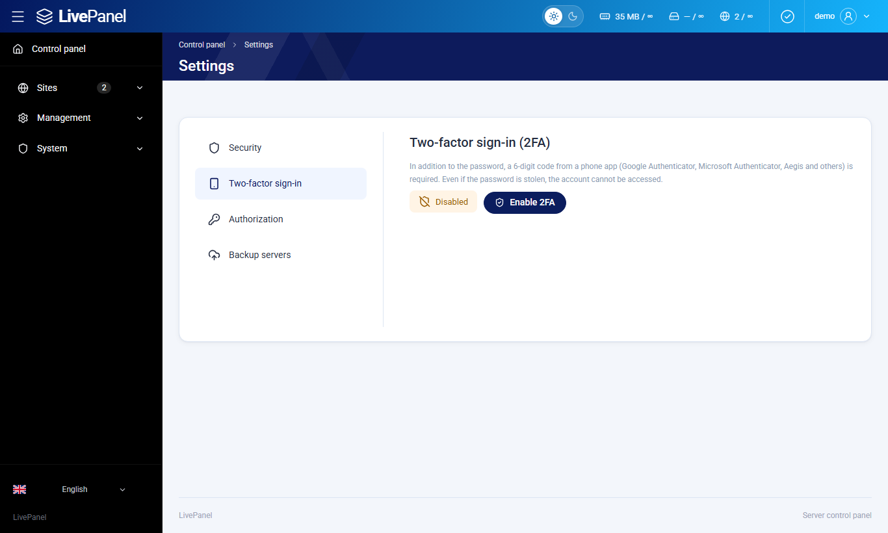
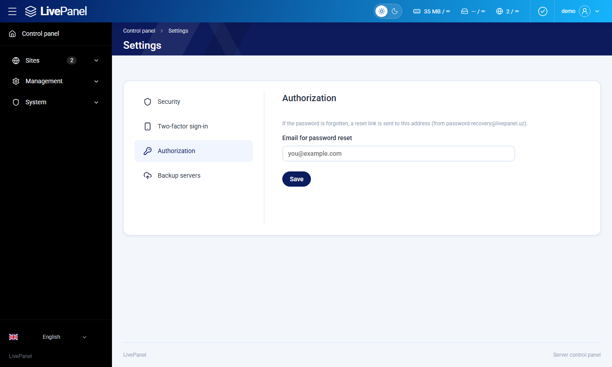
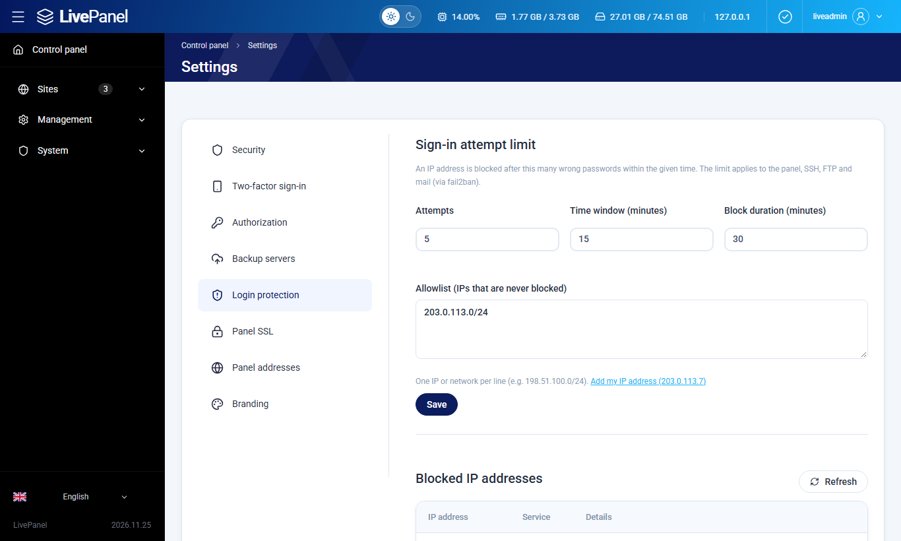
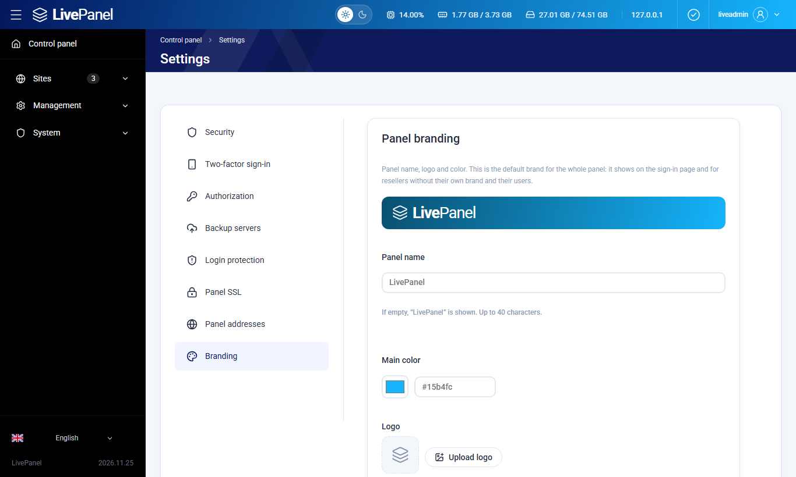

# Panel settings and security

The **Settings** page in the account menu holds the panel and account security settings. The list of sections depends on the role.

## Security: changing the password

Enter the **current password** and the **new password** (6–72 characters). After saving you sign in again with the new password.

## Two-factor sign-in (2FA)

In addition to the password, a 6-digit code from a phone app (Google Authenticator, Microsoft Authenticator, Aegis and others) is required. Even if the password is stolen, the account cannot be accessed.

1. Click **Enable 2FA**.
2. Scan the QR code in the app (or enter the secret key manually).
3. Enter the code shown by the app and click **Confirm and enable**.
4. **Save the recovery codes** — if you lose the phone, you sign in with one of them (each works once; they are not shown again).

For a user who lost both the phone and the codes, an administrator disables 2FA in **Users**.

## Authorization: recovery email

**Email for password recovery** — if you forget the password, “Forgot your password?” on the sign-in page sends a reset link to this address (from password-recovery@livepanel.uz, valid for 30 minutes). Panel notifications also go to this address.

## Login protection (administrator)

An IP address is blocked after this many wrong passwords within the given time. The limit applies to the panel, SSH, FTP and mail (via fail2ban).

- **Attempts**, **Time window (minutes)**, **Block duration (minutes)**.
- **Allowlist** — IPs that are never blocked; add yourself with **Add my IP address**.
- **Blocked IP addresses** — with the service where they were blocked; **Unblock**.
- **Protected services (fail2ban)** — failures and blocks per service. If fail2ban is not installed, install it from **Applications**.

## Branding (administrator and reseller)

- **Panel name** (up to 40 characters), **Main color** and **Logo** (PNG, JPEG, WebP or GIF, up to 1 MB).
- The administrator’s brand is the default for the whole panel: it shows on the sign-in page and for resellers without their own brand.
- A reseller’s brand is seen by the users they create.
- **Reset to default** returns the LivePanel look.

## Other sections

- **Backup servers** — Google Drive and Dropbox: [Backups](backups.md).
- **Panel SSL** and **Panel addresses** — [Panel address and SSL](panel-access.md).
