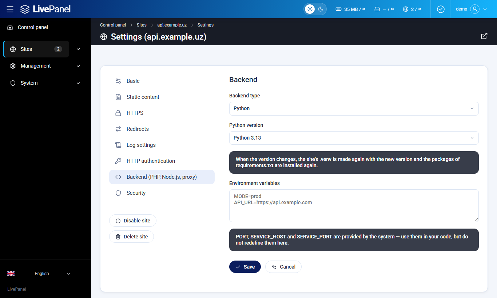

# Python and Node.js sites

Node.js and Python sites work differently from PHP: the application runs as a permanent **systemd service** under the site user and listens on an internal port, and Nginx passes the domain’s requests to it. The service starts by itself when the server reboots and is restarted if it stops.

## Versions

- **Node.js** — Node.js LTS is installed with the panel. Other versions (16–26) are installed in **System → Applications**.
- **Python** — not installed with the panel: install the version you need (3.11, 3.12, 3.13, 3.14, 3.15) in **System → Applications**. The versions come from the official python-build-standalone builds and do not touch the system Python.

You change a site’s version later in **Settings → Backend**.

## A Node.js site

The site folder holds **`app.js`** — the service starts exactly this file with `node app.js`. Your application:

- must take the port from `process.env.PORT` and listen on `127.0.0.1`:

  ```js
  const express = require("express");
  const app = express();
  app.get("/", (req, res) => res.send("Hello!"));
  app.listen(Number(process.env.PORT), "127.0.0.1");
  ```

- if the project lives in another file, load it from `app.js`: `require("./server.js")` or `import("./dist/main.js")`.

Packages: run `npm install` in the site folder over SSH or in the [Terminal](terminal.md), or add it to the [Git deploy](git-deploy.md) command.

## A Python site



In the site folder:

| File | Purpose |
|---|---|
| `app.py` | A starter WSGI application (the `application` object) |
| `gunicorn.conf.py` | Gunicorn settings: which application runs (`wsgi_app`), number of workers, worker class |
| `.venv/` | The site’s own Python virtual environment, Gunicorn is here |
| `requirements.txt` | The project’s packages (optional) |

The service runs `.venv/bin/gunicorn --config gunicorn.conf.py`. To connect your own project, change `wsgi_app` in `gunicorn.conf.py`:

```python
wsgi_app = "myproject.wsgi:application"   # Django
wsgi_app = "app:app"                        # Flask
```

For ASGI applications such as FastAPI install the `uvicorn-worker` package and add:

```python
worker_class = "uvicorn_worker.UvicornWorker"
```

Packages are installed into the site’s environment:

```bash
cd /var/www/<user>/data/www/<domain>
.venv/bin/pip install -r requirements.txt
```

When the Python version changes, `.venv` is made again with the new version and the packages from `requirements.txt` are reinstalled.

## Environment variables

**Settings → Backend → Environment variables** — one `KEY=value` per line (e.g. `DATABASE_URL=...`). Saving restarts the service. `PORT` is set by the system — do not redefine it.

## After changing the code

The application runs in memory, so restart the service after changing files: **Logs → Restart**. Git deploy does this by itself.

## If the application does not work

1. **Logs → Application log** — start-up errors (e.g. a missing package) are here.
2. Check that the application listens on the port in the `PORT` environment variable and on `127.0.0.1`.
3. A **502** from the site means the application is not running or listens on another port.
