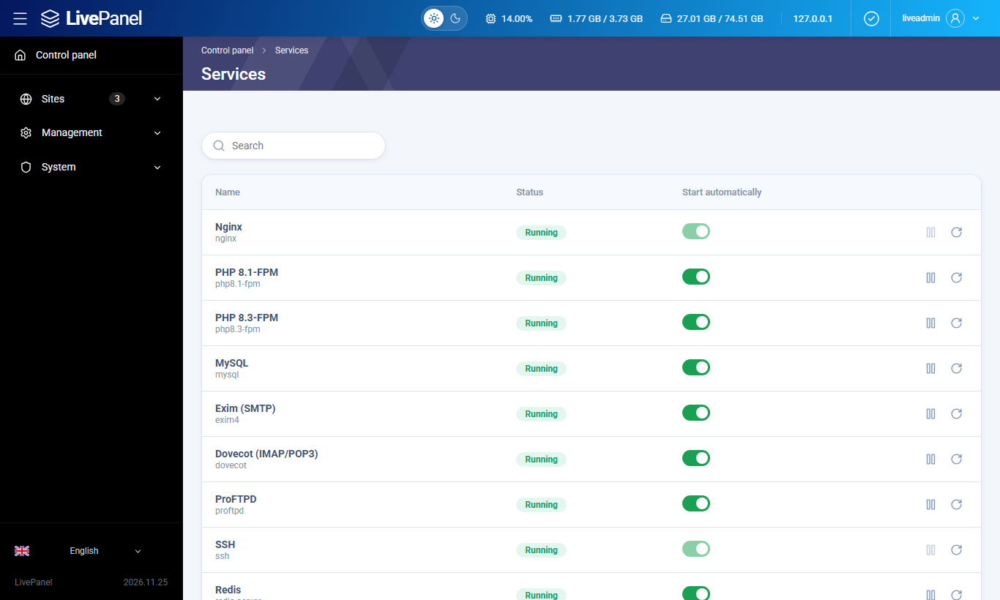

# System services

**System → Services** (for an administrator) shows the state of the main services on the server and lets you control them.

The list has Nginx, PHP-FPM (each installed version), MySQL, PostgreSQL, Exim (SMTP), Dovecot (IMAP/POP3), ProFTPD, SSH, Redis, fail2ban and the other installed services. Each one has:

- its **status** — running or stopped;
- the **Start automatically** switch — whether the service starts when the server reboots;
- actions: **Start**, **Stop**, **Restart**.

Some services keep the connection to the server and cannot be stopped: SSH can only be restarted, and Nginx is needed for the panel to work.

## When you need it

- A service does not pick up a changed setting — **Restart**.
- A service is not used (e.g. you do not need mail) — stop it and turn off automatic start to free memory.
- If an important service stops, the panel emails the administrator — [Updates and notifications](updates-notifications.md).

A site’s own service (PHP pool, Node.js/Python application) is restarted in the site’s **Logs** section — [Logs](logs.md).
