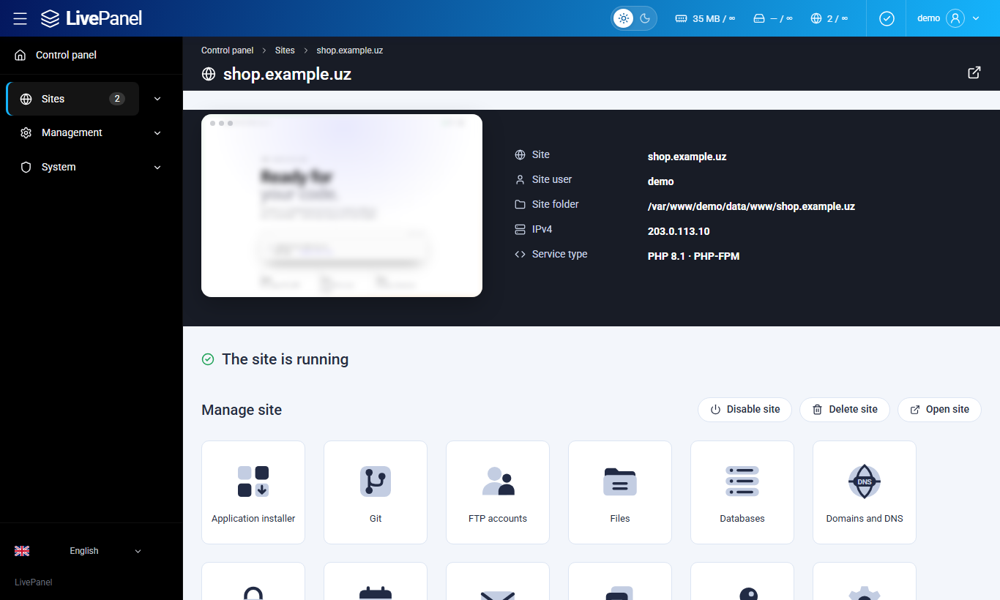

# Managing a site

Click a card in the site list to open the **site page**. It shows the main facts of the site and all its sections as tiles.

## Site details

- **Site** — the domain; the icon next to it opens the site in a new tab.
- **Site user** — the Linux user the site runs under.
- **Site folder** — the site’s files.
- **IPv4** — the IP address the site points to.
- **Service type** — PHP version and handler, Node.js, Python, static or proxy.
- Status: **The site is running**, **The site is running with errors** or **The site is disabled**.

## Site sections

| Tile | Article |
|---|---|
| Application installer | [Installing CMS and frameworks](app-installer.md) |
| Git | [Deploying from Git](git-deploy.md) |
| FTP accounts | [FTP, SFTP and SSH](ftp-ssh.md) |
| Files | [File manager](file-manager.md) |
| Databases | [Databases](databases.md) |
| Domains and DNS | [Domains and DNS](dns.md) |
| SSL certificates | [SSL certificates](ssl.md) |
| Scheduler | [Scheduler (cron)](cron.md) |
| Mail | [Mail](mail.md) |
| Backups | [Backups](backups.md) |
| Site access, Scanning | [Site security and scanning](site-security.md) |
| Settings | [Site settings](site-settings.md) |
| Statistics | [Statistics and traffic](statistics.md) |
| Logs | [Logs](logs.md) |
| New subdomain | Opens the wizard to create a subdomain with this site’s user |

Tiles depend on the account’s permissions: without “Manage files”, for example, the Files tile is not shown.

## Disabling and enabling a site

**Disable site** stops the site for a while: visitors see “This site is disabled” (403) and the Node.js/Python service stops. Files, databases and settings stay. **Enable site** brings it back.

## Deleting a site

**Delete site** removes the site completely:
- the site files, Nginx and PHP/Node/Python configuration and logs;
- the databases and Git settings of the site;
- the Linux user too, if it has no other sites.

You confirm with the code shown in the dialog. **This cannot be undone** — make a [backup](backups.md) first.
