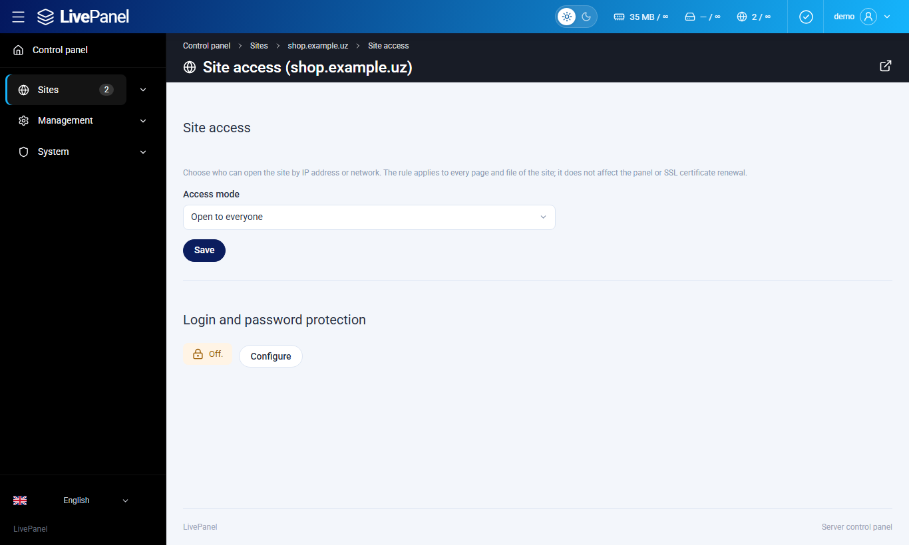
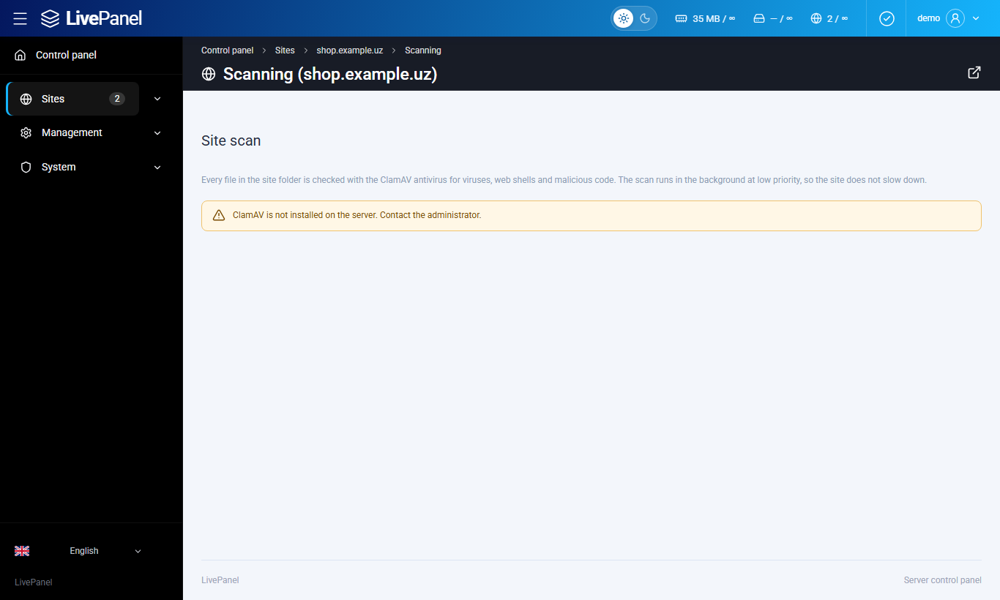
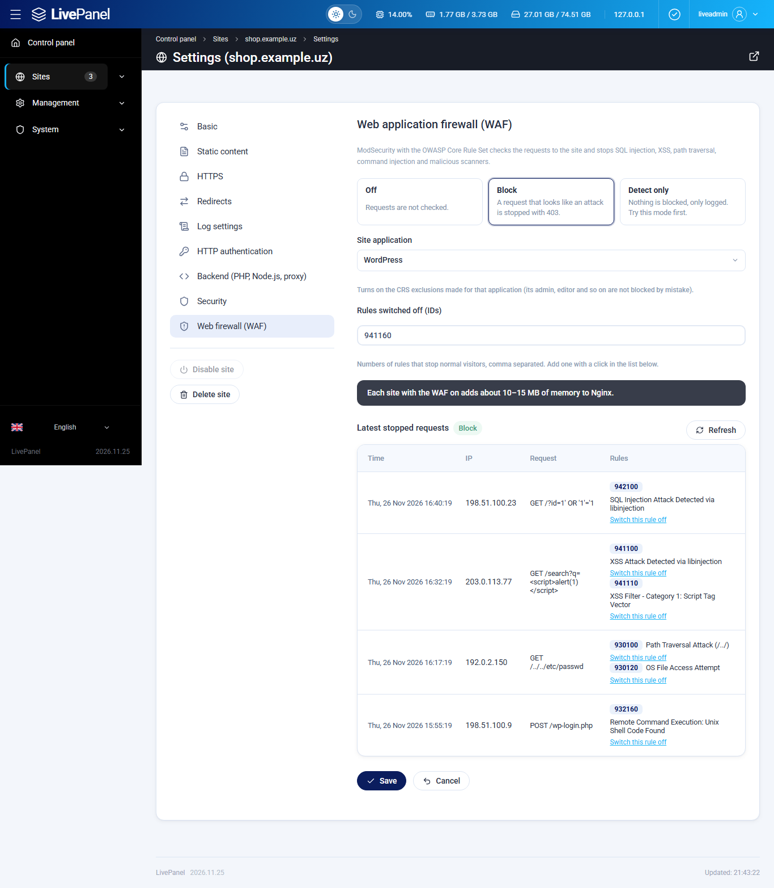

# Site security and scanning

## Site access (by IP)

The **Site access** tile on the site page chooses who can open the site by IP address or network. The rule applies to every page and file of the site; it does not affect the panel or SSL certificate renewal.

**Access mode:**

- **Open to everyone** — the default.
- **Allow only the listed addresses** — for an office or development servers. Anyone not on the list sees “403 Forbidden” — remember to add your own IP address.
- **Block the listed addresses** — for troublesome bots and attackers.

Write one IP (`203.0.113.7`) or network (`198.51.100.0/24`) per line; IPv6 works too.

> If the site is behind a proxy such as Cloudflare, Nginx sees the proxy’s address, not the visitor’s — the rule will not work as expected.

The page also shows whether **login and password protection** is on; **Configure** opens it in the site settings ([Site settings](site-settings.md) → HTTP authentication).

## Scanning (antivirus)

The **Scanning** tile checks every file in the site folder with the **ClamAV** antivirus for viruses, web shells and malicious code. The scan runs in the background at low priority, so the site does not slow down.

ClamAV must be installed on the server: the administrator installs it from **System → Applications** → `clamav`. The virus database is ~300 MB, and a scan uses ~1 GB of RAM.

1. Click **Scan**. It takes a few minutes depending on the site size.
2. The result: **No threats found** or **N suspicious files found** — with the file path and the threat name.
3. For each file found:
   - **Quarantine** — the file is taken out of the site and no longer runs; if it was a false alarm, **Restore** it;
   - **Delete for good**.

If the site was hacked: remove the malicious files, update the CMS and plugins, and change every password (panel, FTP, database, CMS administrator).

## Web application firewall (WAF)

**Site settings → Web firewall (WAF)** — ModSecurity with the OWASP Core Rule Set (CRS 3.3), per site. It checks the requests to the site and stops SQL injection, XSS, path traversal (`../`), command injection and malicious scanners.

**Modes:**

- **Off** — requests are not checked;
- **Detect only** — nothing is blocked; suspicious requests are only logged. On a new site, run this mode for a day or two first;
- **Block** — a request that looks like an attack is stopped with `403`.

**Site application** — choosing WordPress, Drupal, Nextcloud, DokuWiki or XenForo turns on the CRS exclusions made for it, so its admin, editor and so on are not blocked by mistake.

The **Latest stopped requests** table shows the time, IP, request and the rules that fired (ID and description). If a rule stops normal visitors (a false positive), click **Switch this rule off** next to it — the ID goes to **Rules switched off** — then **Save**. The rule is switched off for this site only.

The first time, the panel installs the ModSecurity packages itself (up to a minute). Each site with the WAF on adds about 10–15 MB of memory to Nginx. Through the API: the `waf`, `waf_app`, `waf_skip` site settings, and the events — `GET /sites/waf` ([API v2](api-reference.md)).

## Other protection

- Request rate limit for the site — [Site settings](site-settings.md) → Security.
- Server-level firewall — [Firewall](firewall.md).
- Protection of the panel, SSH, FTP and mail from password guessing — [Panel settings and security](panel-settings.md).
