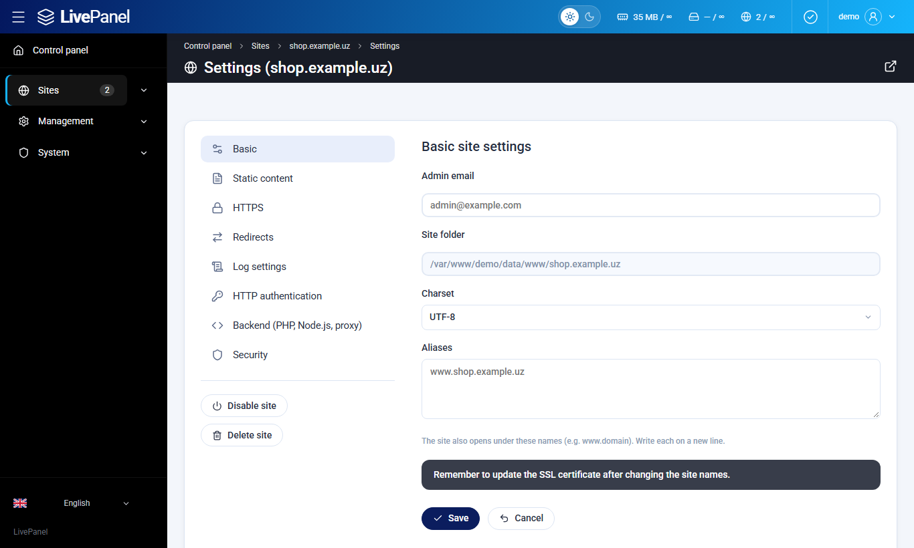
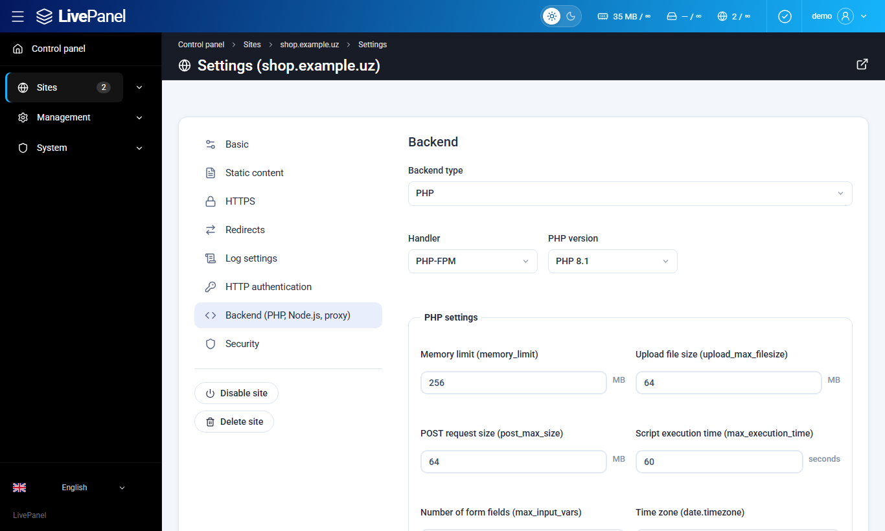

# Site settings

The **Settings** tile on the site page opens the site’s Nginx, backend and security settings: sections on the left, their fields on the right. Changes are applied with **Save**: the panel checks the Nginx configuration first and restores the previous state on an error — the site does not go down.

## Basic

- **Admin email** — the site administrator’s email (shown on some error pages).
- **Site folder** — where the site files are.
- **Charset** — the charset Nginx sends, usually UTF-8.
- **Aliases** — other names the site opens at (e.g. `www.example.uz`), one per line. Reissue the SSL certificate after changing them.

## Static content

- **Enable gzip compression** and **Gzip level** — compress pages; level 5 is recommended.
- **Serve static files with Nginx** — images, CSS and JS are served by Nginx without going to PHP or the application (faster).
- **Static file extensions** and **Cache period (days)** — how long browsers keep these files.

## HTTPS

- **Redirect to HTTPS** — every HTTP request goes to HTTPS.
- **Enable HSTS** — tells browsers to open the site over HTTPS only.
- **Enable HTTP/2**.

These need an SSL certificate first — [SSL certificates](ssl.md).

## Redirects

Send visitors of a given address elsewhere: **From**, **To** and **Code** (301 permanent, 302 temporary). For example `/old-page` → `/new-page`.

## Log settings

Turn the **Access log** and **Error log** on or off. With the access log off, traffic and visitor statistics are not counted — [Statistics and traffic](statistics.md).

## HTTP authentication

**Protect the site with a login and password** — the browser asks for them when the site opens. Handy for staging or internal sites.

## Backend

**Backend type** — what the site runs on: PHP, Node.js, Python, static site or reverse proxy. You can switch the type without recreating the site:

- the site files stay;
- the new backend is set up and started first, then the old service (PHP pool or application service) stops;
- a starting `app.js` (Node.js) or `app.py` and `gunicorn.conf.py` (Python) is created when missing;
- if any step fails, the site stays on its previous backend.

Fields by type:

- **PHP** — the handler (PHP-FPM, FastCGI, Apache module, CGI), the PHP version and **PHP settings**: `memory_limit`, `upload_max_filesize`, `post_max_size`, `max_execution_time`, `max_input_vars`, time zone, `display_errors`.
- **Node.js** — the Node.js version and **environment variables**.
- **Python** — the Python version and environment variables. When the version changes, `.venv` is made again with it — [Python and Node.js sites](python-nodejs.md).
- **Reverse proxy** — the address requests go to, e.g. `http://127.0.0.1:3000`.

| PHP handler | What it is |
|---|---|
| PHP-FPM | A separate pool per site, running as the site owner. The best choice in most cases |
| FastCGI | A separate php-cgi process for the site |
| Apache module | Apache mod_php (mpm-itk), `.htaccess` works. System PHP version only |
| CGI | php-cgi starts on every request. Slower, for old applications |

## Security

- **Request rate limit** — how many requests per second or minute one IP may make (protection from floods and bots).
- **Burst** — allow short spikes and serve them without delay.

Restricting access by IP — [Site security and scanning](site-security.md).

## Speed (Pro)

- **Page cache** — Nginx keeps ready PHP pages and serves them without running PHP. **Keep a page (minutes)** sets for how long. Logged-in users, carts and checkout, admin pages, forms (POST) and addresses with parameters are never cached. WordPress clears the cache by itself when content changes; there is a **Clear cache** button too. Only for PHP sites with the PHP-FPM or FastCGI handler.
- **WebP and AVIF images** — WebP and AVIF copies are made next to JPEG/PNG images and sent to the browsers that support them; the originals do not change. New images are processed every 10 minutes. When turned off, the copies are removed.
- **Redis for this site** — a Redis of the site’s own, reached only by the site user through a socket. The section shows the **Memory limit (MB)**, the memory used, a **Clear Redis** button and ready lines for WordPress (wp-config.php) and Laravel (.env).

## Protection

- **Attack mode (Premium)** — every visitor first passes a short browser check (about 2 seconds, once in 12 hours); bots without JavaScript never reach the site. Turn it on only during an attack: search engines, APIs, payment callbacks and webhooks cannot pass the check either.
- **Blocking by country (Pro)** — **Only the chosen countries** or **All but the chosen countries**; the others get “403 Forbidden”. Country data: the free DB-IP database (refreshed monthly).
