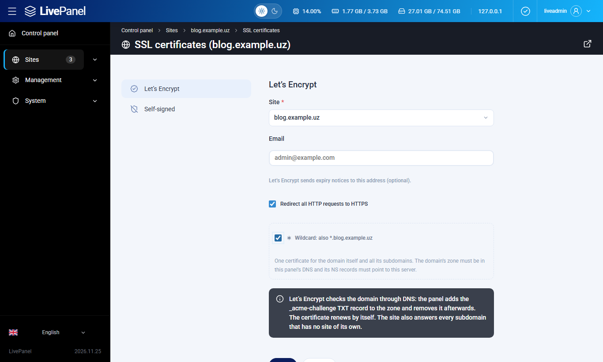

# SSL certificates

An SSL certificate encrypts the traffic between the site and the browser, and the site opens with `https://`. The panel gets a free **Let’s Encrypt** certificate in one click and renews it before it expires.


## Getting a certificate

1. The domain (and the `www` alias) must **point to this server’s IP address**. DNS changes take from minutes to a few hours to spread.
2. Open the **SSL certificates** tile on the site page.
3. Click **New certificate**.
4. Choose the site and the type:
   - **Let’s Encrypt** — trusted, free, 90 days; the panel renews it.
   - **Self-signed** — encrypts the traffic, but browsers warn. For test sites whose domain does not point here yet.
5. **Email** is optional: Let’s Encrypt writes there about expiry problems.
6. Turn on **Redirect all HTTP requests to HTTPS**.
7. Confirm. The certificate is installed in a few seconds.

The certificate covers the site’s domain and all its aliases.

## The certificate list

The table shows the site, type, validity and the HTTPS redirect. The row menu has:

- **Reissue** — get the certificate again (e.g. after adding an alias);
- turning the **HTTPS redirect** on or off;
- **Remove certificate** — the site works over HTTP only.

## Wildcard certificate (Premium)



A wildcard certificate is one certificate for the domain itself and **all its subdomains**: `example.uz` and `*.example.uz`. It is available only on panels with a **Premium** license.

Let’s Encrypt checks a wildcard name through DNS only: it needs the TXT record `_acme-challenge.<domain>`. For the panel to place it, one of two ways is enough:

1. **The domain’s DNS is on this server** — the domain’s zone is in the panel ([Domains and DNS](dns.md)) and its NS servers at the registrar point to this server (`dig NS example.uz`).
2. **The DNS stays elsewhere** (registrar or DNS provider) — you add **one NS record** there, which hands only the check name to this server:

   ```
   _acme-challenge.example.uz.  NS  example.uz.
   ```

   The panel shows the exact record — in the error box the first time you ask for the wildcard. The NS value is a name that points to this server (usually the domain itself). No other DNS record changes. Wait 5–10 minutes after adding it and ask for the certificate again.

How to get it: **New certificate** → **Let’s Encrypt** → tick **Wildcard: also \*.domain**. Let’s Encrypt checks the domain through DNS. The panel adds the `_acme-challenge` TXT record to the zone and removes it after the check. The certificate renews by itself the same way.

A site with a wildcard certificate also answers every subdomain that has no site of its own (`*.domain` is added to `server_name`). Subdomains with their own site keep opening that site.

Errors:

- **DNS not on this server** — add the NS record the panel shows (way 2), or move the domain’s NS to this server (way 1);
- **no zone** — the domain’s NS is already here but the panel has no zone for it: create it in **Domains and DNS**.

## Automatic renewal

Let’s Encrypt certificates renew by themselves before they expire. If a certificate has less than 14 days left and did not renew, the panel emails the site owner and the administrator.

## If the certificate is not issued

- **The domain points elsewhere** — check the A record: `nslookup example.uz`.
- **Port 80 is closed** — Let’s Encrypt checks over port 80. The firewall must keep the HTTP rule — [Firewall](firewall.md).
- **Cloudflare proxy (orange cloud)** is on — turn it off for a moment, or set Cloudflare’s SSL mode to “Full”.
- **Too many attempts** — Let’s Encrypt limits attempts per domain; try again in an hour.

SSL for the panel itself — [Panel address and SSL](panel-access.md).
