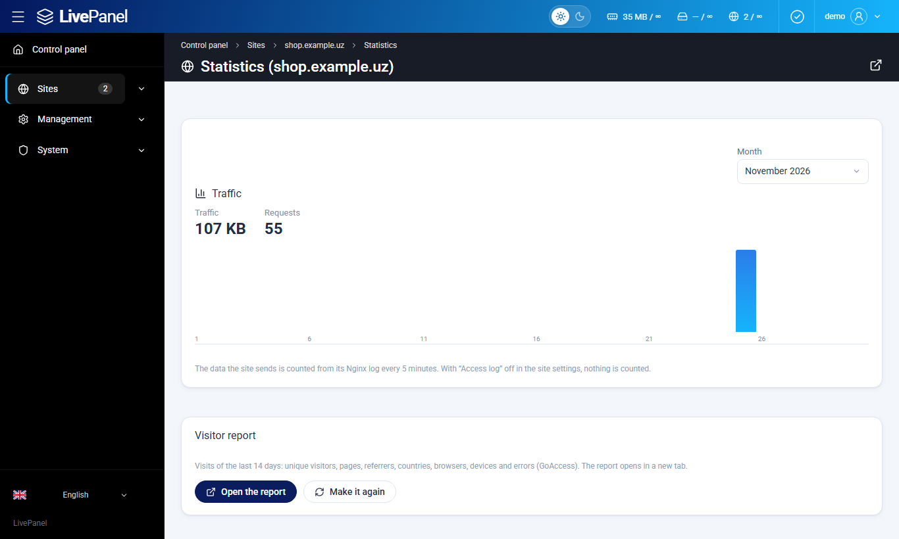
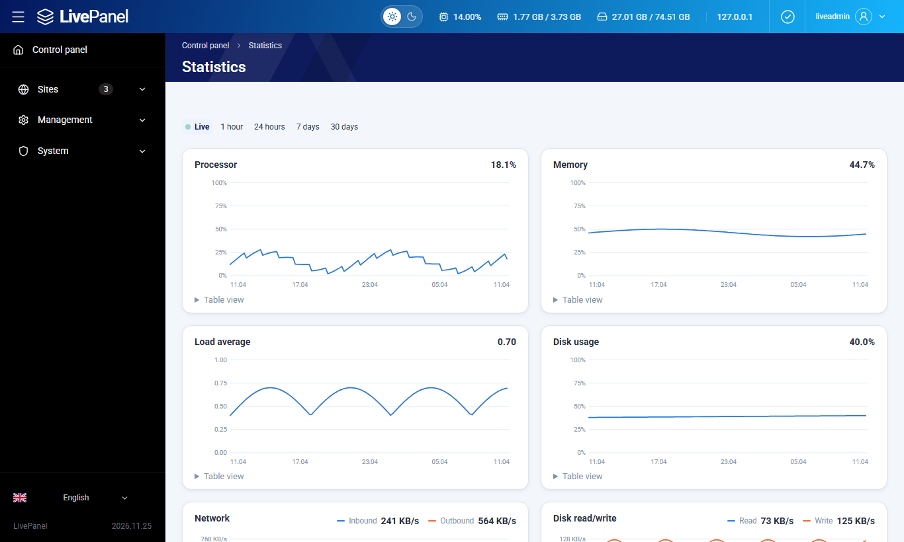

# Statistics and traffic

## Site statistics

The **Statistics** tile on the site page shows:

- **Traffic** — the amount of data the site sent and the number of requests in the chosen month;
- a **daily chart** — hover over a day’s bar to see the date, size and number of requests;
- the **Month** selector — the current and the previous 11 months.

Traffic is counted from the site’s Nginx access log every 5 minutes and kept for 400 days. With the **access log** off in the site settings, traffic is not counted.

### Visitor report

**Open the report** opens a detailed report (GoAccess) of the visits of the last 14 days in a new tab:

- unique visitors and requests per day;
- the most visited pages and files, pages not found (404);
- where visitors came from (referrers), countries;
- browsers, operating systems, devices and bots;
- response codes and the files with the most traffic.

The report is cached for 10 minutes; **Make it again** rebuilds it right away. Visitor IP addresses are anonymized in the report.

## Server statistics

**System → Statistics** (for an administrator) shows the server load in charts:

- CPU, memory, disk use and load average;
- network (in/out) and disk read/write speed.

Periods: **Live** (refreshed every 2 seconds), **1 hour**, **24 hours**, **7 days**, **30 days**. Each chart can also be shown as a table.

## Traffic of accounts and sites

At the bottom of the same page is **Traffic: accounts and sites**: the traffic and requests of every account (the sum of all its sites) and every site in the chosen month, with a total daily chart. Handy for watching how much traffic your customers use.
