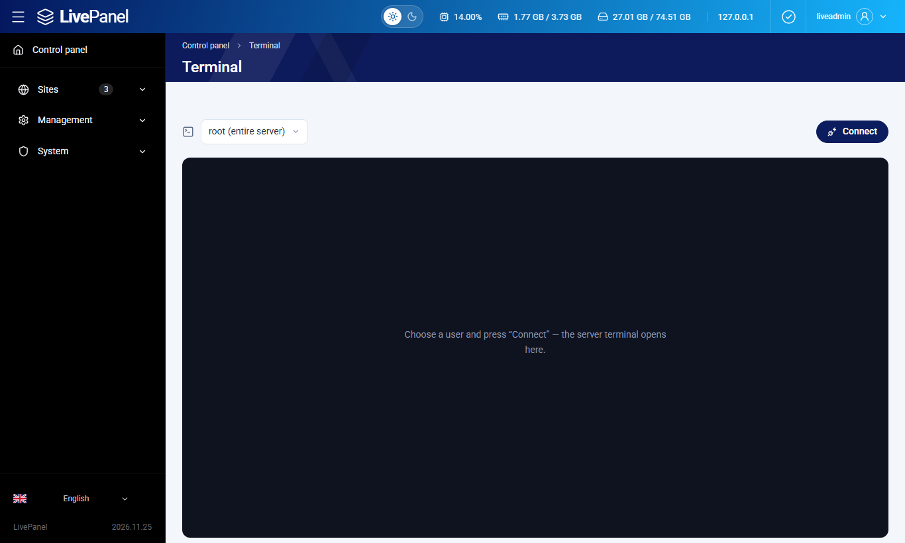

# Terminal

**System → Terminal** opens a server terminal right in the browser — no SSH program needed.

1. Choose the user:
   - **root (whole server)** — administrators only; commands affect the whole server;
   - a site user — the terminal opens in the same isolated environment as SSH: only the user’s home folder is visible.
2. Click **Connect**.

The usual commands work in the terminal: `ls`, `cd`, `nano`, `git`, `composer`, `npm`, `php`, `.venv/bin/pip` in a site folder and so on. The session closes after 30 minutes without activity; **Reconnect** opens a new one.

A regular user can use the terminal only with SSH access — the administrator turns it on in **Users** ([Users, roles and limits](users.md)).
