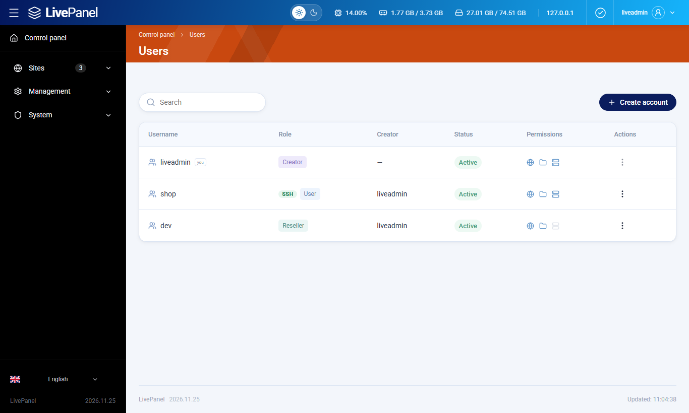
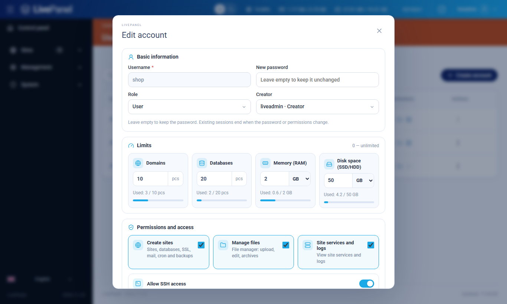

# Users, roles and limits

Panel accounts are created and managed in **System → Users**. Give every customer a separate account and they see and manage only their own sites.

## Roles

| Role | What it can do |
|---|---|
| **Creator** | The main administrator created by the installer (`liveadmin`). Access to everything; cannot be deleted |
| **Admin** | Manages the whole server and all accounts |
| **Reseller** | Manages the users they created and gives them limits; can set their own brand |
| **User** | Works only with their own sites; does not see server settings |

## Creating an account

1. Click **Create account**.
2. **Basic information**: login, password, role and (for an administrator) which account it belongs to.
3. **Limits** (on the Pro and Premium plans; 0 — unlimited):

   | Limit | Meaning |
   |---|---|
   | Domains | How many sites can be created |
   | Databases | Number of databases |
   | Memory (RAM) | How much RAM the sites may use in total (at least 32 MB) |
   | Disk space | Disk for site files, uploads and mail |
   | Users | How many users a reseller may create |

4. **Permissions and access**:
   - **Create sites** — sites, databases, SSL, mail, cron and backups;
   - **Manage files** — the file manager: upload, edit, archives;
   - **Site services and logs** — view services and logs;
   - **Allow SSH access** — SSH/SFTP with the panel password; the user sees only their own folder.
5. Save.

## Managing accounts

The row menu has: edit, change password, **disable 2FA** (for a user who lost their phone) and delete. With **Account active** off, the user cannot sign in.

## How limits work

- When the **domain or database** limit is reached, no new site or database is created.
- The **disk** limit uses Linux disk quotas. If quotas are off, the panel shows an **Enable quotas** button (ext4 only; a copy of the old `/etc/fstab` is kept).
- **RAM** limit: when the account’s sites reach 90% of it, the account is **blocked** and its sites are disabled (files and databases are kept). The list shows a “RAM block” badge and the administrator gets an email. To lift the block, edit the account, turn on **Account active** and save — the sites are enabled again.

A user sees their limits and usage in the top bar.

## Resellers and branding

A reseller gives the users they create limits within their own limits. In **Settings → Branding** a reseller sets the panel name, logo and color — their customers see the panel with that brand ([Panel settings and security](panel-settings.md)).
