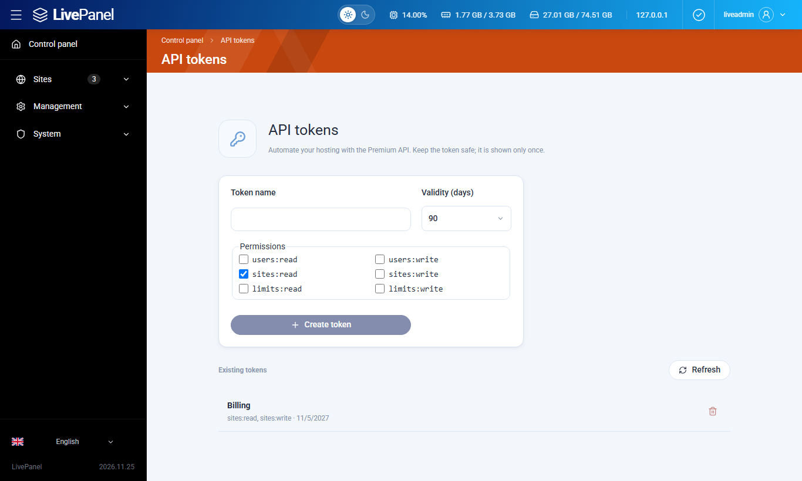
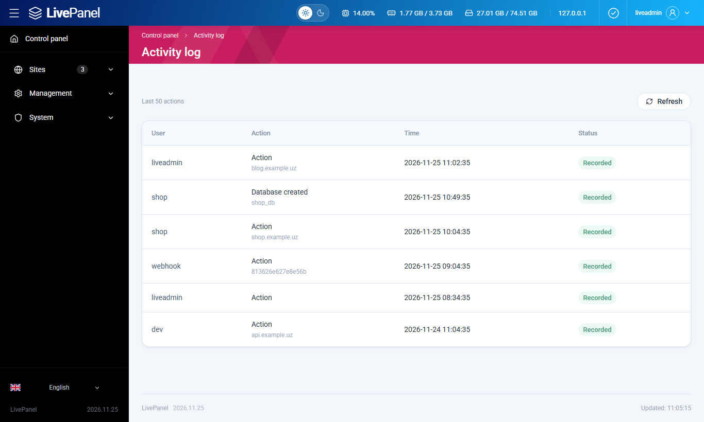

# API-токены и журнал действий

## API-токены (Premium)

На тарифе **Premium** услуги хостинга можно автоматизировать через API: например, ваша биллинговая система после оплаты создаёт клиенту аккаунт и сайт, меняет его лимиты или блокирует по окончании срока.

### Создание токена

1. Откройте **Система → API-токены**.
2. **Название токена** — например «Биллинг».
3. **Срок действия (дней)**.
4. **Права** — токен может выполнять только отмеченные действия:

   | Право | Что делает |
   |---|---|
   | `users:read` / `users:write` | Просмотр / создание и изменение аккаунтов |
   | `sites:read` / `sites:write` | Просмотр / создание и изменение сайтов |
   | `limits:read` / `limits:write` | Просмотр / изменение лимитов |

5. Нажмите **«Создать токен»**. **Сразу скопируйте токен** — он показывается только один раз.

В запросах токен передаётся в заголовке `Authorization: Bearer <токен>`. В списке **«Существующие токены»** ненужный токен можно **отозвать** — он сразу перестаёт работать.

> Создавайте токены с минимально нужными правами и храните их в секрете: токен так же силён, как пароль панели.

## Журнал действий

**Система → Журнал действий** показывает, кто, когда и что делал в панели: создание и удаление сайтов, базы, загрузку файлов, резервные копии, деплой из Git, изменения файрвола, входы и многое другое. В каждой записи — пользователь (или `webhook`), действие и время.

Администратор видит действия всех аккаунтов, реселлер — своих пользователей. Если что-то на сайте изменилось и непонятно почему, или нужно узнать, кто удалил файл, — смотрите сюда в первую очередь.
