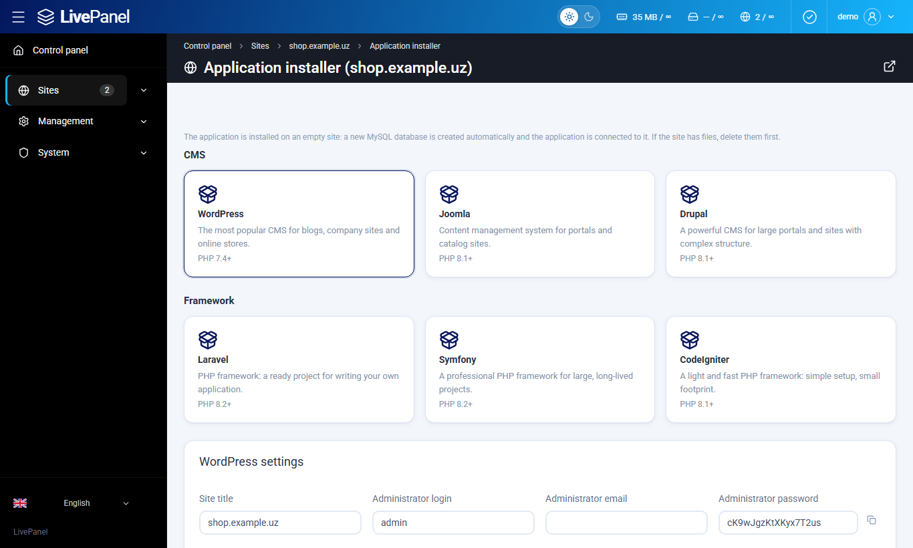

# Установка CMS и фреймворков

Панель устанавливает популярные CMS и фреймворки в один клик: скачивает, при необходимости создаёт базу данных, настраивает и запускает. Установить приложение можно в двух местах:

- **Мастер создания сайта → CMS / Фреймворк** — сайт и приложение создаются вместе ([Создание сайта](create-site.md));
- плитка **«Установка приложений»** существующего пустого сайта.

## Приложения

| Платформа | CMS | Фреймворки |
|---|---|---|
| **PHP** | WordPress (PHP 7.4+), Joomla (8.1+), Drupal (8.1+) | Laravel (8.2+), Symfony (8.2+), CodeIgniter (8.1+) |
| **Node.js** | Strapi (Node.js 20+), Ghost (22+) | Express (18+), Next.js (20+), NestJS (20+) |
| **Python** | Wagtail (Python 3.11+) | Django, Flask, FastAPI (3.11+) |

Приложение должно соответствовать типу сайта: PHP-приложение — на PHP-сайт, Node.js-приложение — на Node.js-сайт и т. д. Если версия PHP/Node.js/Python сайта слишком старая, панель предупредит — поднимите версию в [настройках сайта](site-settings.md).

## Установка

1. Сайт должен быть **пустым** (только стартовая страница панели). Если на нём есть файлы, сначала удалите их или создайте новый сайт.
2. Откройте плитку **«Установка приложений»** и выберите приложение.
3. Для приложений с администратором (WordPress, Joomla, Drupal, Wagtail, Django) заполните:
   - **Название сайта**;
   - **Логин**, **email** и **пароль администратора** (не менее 12 символов; панель предложит готовый).
4. Нажмите **«Установить …»**.

Ход установки показывается по шагам (база, загрузка, настройка, установка, запуск). Это может занять несколько минут; установка продолжается, даже если закрыть страницу.

## Результат

После установки вы получите:

- адрес сайта и ссылку на **панель администратора** (например `/wp-admin/` для WordPress, `/admin/` для Django и Wagtail, `/docs` для FastAPI);
- **имя базы, пользователя и пароль** — сохраните их.

При ошибке показываются причина и лог процесса; сайт возвращается в исходное состояние, и можно попробовать снова кнопкой **«Новая установка»**.

## По платформам

- **PHP CMS** — файлы загружаются в папку сайта и подключаются к новой базе MySQL. WordPress устанавливается через WP-CLI.
- **PHP-фреймворки** — проект создаётся через Composer; корнем сайта становится папка `public/` проекта.
- **Node.js** — проект создаётся в папке сайта, при необходимости собирается (`npm run build`) и запускается службой сайта. Strapi и Ghost получают базу MySQL.
- **Python** — проект создаётся в папке сайта, пакеты ставятся в `.venv` сайта, запускает его Gunicorn. Django и Wagtail хранят данные в файле SQLite, статику отдаёт WhiteNoise.

Как дальше управлять проектами Python и Node.js — [Сайты на Python и Node.js](python-nodejs.md).
