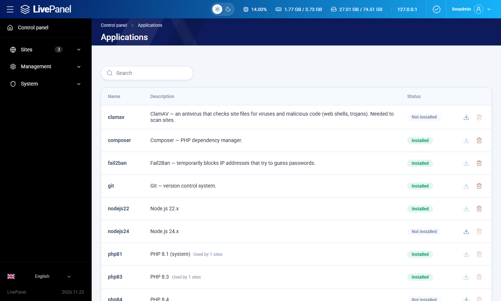

# Приложения (программы сервера)

**Система → Приложения** (для администратора) — место, где на сервер устанавливаются и удаляются дополнительные программы. Каждая установка идёт в фоне; её состояние видно в списке.

## Что доступно

| Группа | Приложения |
|---|---|
| PHP | PHP 5.6 – 8.6 (каждая версия с FPM, CGI, CLI и основными расширениями). системная версия — PHP 8.1 на Ubuntu 22.04, PHP 8.3 на Ubuntu 24.04 |
| Node.js | Node.js 16 – 26 (официальные сборки nodejs.org, проверка по sha256) |
| Python | Python 3.11 – 3.15 (python-build-standalone, проверка по sha256) |
| Службы | Redis, Memcached, fail2ban, BIND (DNS), SpamAssassin, ClamAV, веб-почта Roundcube |
| Базы данных | PostgreSQL, phpMyAdmin (системная часть) |
| Инструменты | Git, Composer, WP-CLI, jpegoptim, optipng, AWStats, ttyd |

## Установка и удаление

- Значок **«Установить»** устанавливает приложение. Это может занять несколько минут; состояние меняется с **«Устанавливается»** на **«Установлено»**.
- Значок **«Удалить»** удаляет его.
- Системные части (например системный PHP, phpMyAdmin) не удаляются.
- Версию, которую используют сайты, удалить нельзя — в списке написано «используют N сайтов». Сначала переведите сайты на другую версию.
- При ошибке состояние становится **«Ошибка»** и показывается причина.

## Что для чего нужно

| Задача | Установите |
|---|---|
| Создать Python-сайт | Python 3.x |
| Перевести сайт на новый PHP | PHP 8.x |
| Проверять сайты на вирусы | ClamAV |
| Защитить SSH, FTP и почту от подбора паролей | fail2ban |
| Сделать сервер DNS-сервером | BIND |
| Открывать почту в браузере | Roundcube |
| Базы PostgreSQL | PostgreSQL |
| Кэширование (WordPress, Laravel) | Redis или Memcached |
