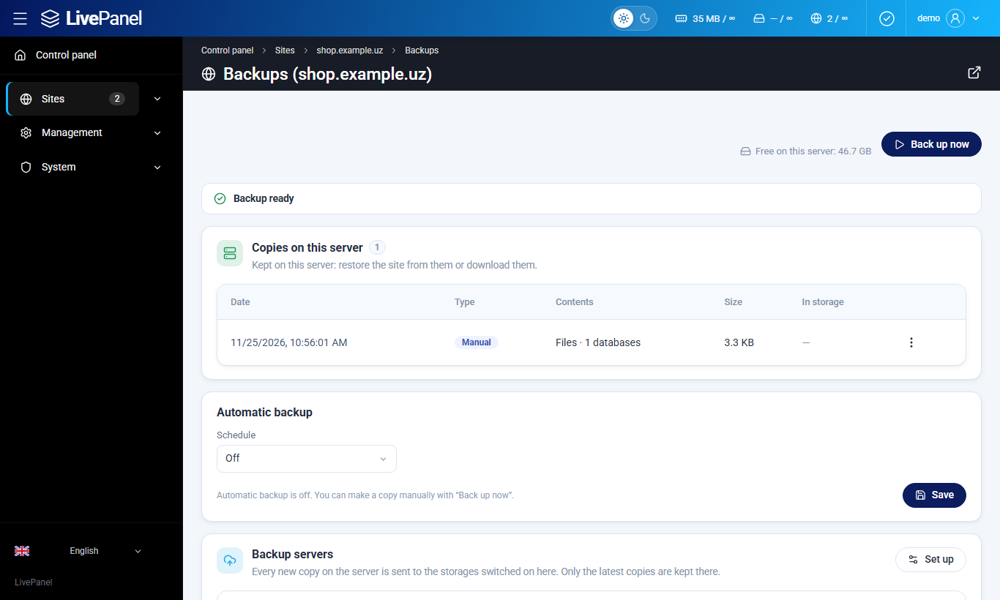
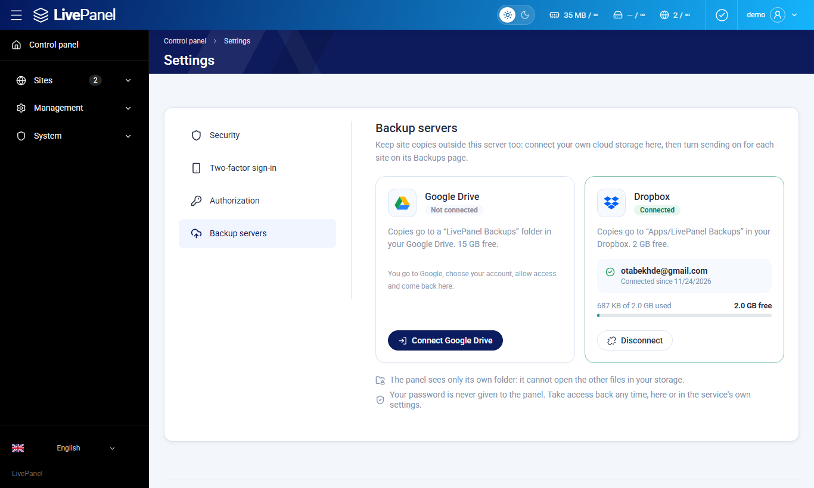

# Резервные копии

Панель делает резервные копии файлов и баз данных сайта, создаёт копии по расписанию, восстанавливает в один клик и отправляет копии в **Google Drive** или **Dropbox**.

Откройте плитку **«Резервные копии»** на странице сайта. Вверху — свободное место на сервере и кнопка **«Создать копию сейчас»**.

## Копии на сервере

У каждой копии — дата, тип (**Вручную**, **Автоматически** или **Из хранилища**), содержимое (файлы, число баз), размер и в какие хранилища она отправлена. В меню строки:

- **«Скачать»** — сохранить копию на компьютер архивом `.tar`;
- **«Восстановить»** — вернуть сайт к состоянию этой копии;
- **«Удалить»** — копия удаляется с сервера (копии в хранилищах не удаляются).

### Восстановление

1. Выберите **«Восстановить»** в меню копии.
2. Отметьте, что восстанавливать: **Файлы** и/или **Базы данных**.
3. Подтвердите.

> При восстановлении файлов папка сайта заменяется полностью — текущие файлы удаляются. Базы возвращаются к состоянию из копии.

## Автоматическое копирование

В разделе **«Автоматическое копирование»**:

- **Расписание** — **Выключено**, **Каждый день** или **Каждую неделю** (с днём недели);
- **Время (сервера)** — по часам сервера;
- **Сколько копий хранить** — старые автоматические копии удаляются сами (ручные и полученные из хранилища — нет);
- что копировать: **Файлы** и **Базы данных**.

Здесь же виден результат последнего автоматического копирования.

## Серверы резервных копий (Google Drive, Dropbox)

Копия вне сервера позволяет восстановить сайт, даже если сервер выйдет из строя.

### 1. Подключите хранилище

В **Настройки → Серверы резервных копий**:

- **«Подключить Google Drive»** — откроется страница Google; выберите аккаунт и разрешите доступ. В окне Google отметьте галочку доступа к **файлам Google Диска** — иначе подключение не произойдёт.
- **«Подключить Dropbox»** — на странице Dropbox нажмите **Allow**.

Панель видит только созданную ею папку («LivePanel Backups» в Google Drive, «Apps/LivePanel Backups» в Dropbox) — к остальным вашим файлам доступа нет. Ваш пароль от Google или Dropbox панели не передаётся. Каждый пользователь подключает своё хранилище; на карточке видно занятое и свободное место в нём.

### 2. Включите отправку для сайта

На странице **«Резервные копии»** сайта, в разделе **«Серверы резервных копий»**:

1. Включите переключатель в строке хранилища.
2. Укажите, **сколько копий хранить в хранилище** (1–60).
3. **«Отправить сейчас»** — сразу отправляет существующую копию.

После этого каждая новая копия на сервере сама отправляется в хранилище в течение нескольких минут. Старые копии сверх указанного числа удаляются из хранилища.

> «Отправить сейчас» не создаёт новую копию, а только отправляет копии с сервера. Если копий нет, сначала нажмите **«Создать копию сейчас»**.

### 3. Восстановление из хранилища

В таблице **«Копии в хранилище»** видно состояние каждой копии: **«Есть и на сервере»**, **«Только в хранилище»** или **«С другого сервера»**. Для копии, которая есть только в хранилище, кнопка **«Получить на сервер»** возвращает её на сервер — затем восстановите её как обычно. Так же можно **перенести сайт на другой сервер**: подключите на новом сервере то же хранилище и получите копию.
