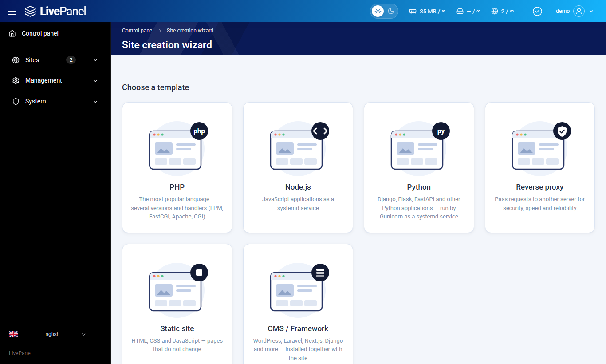
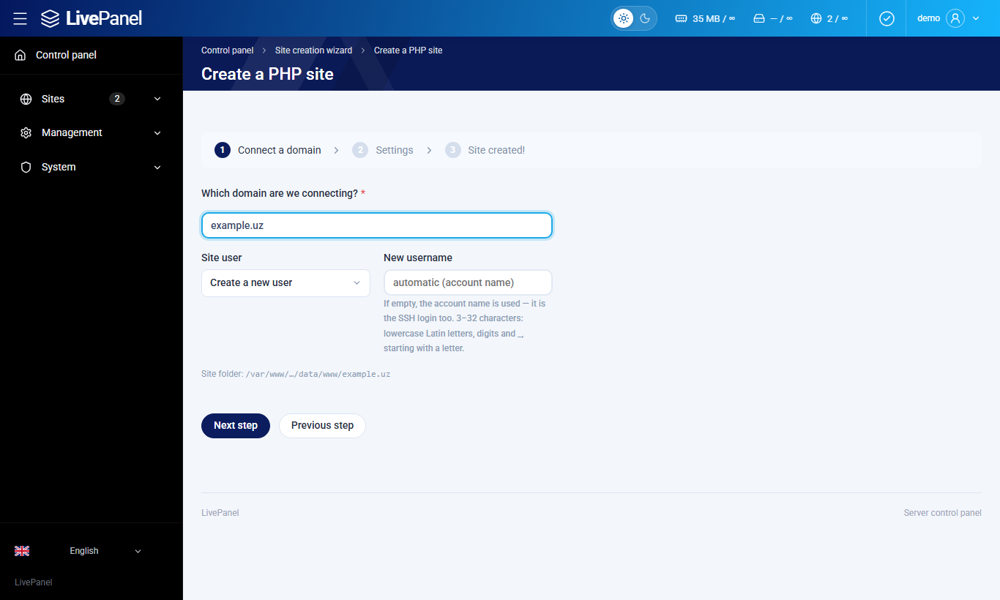
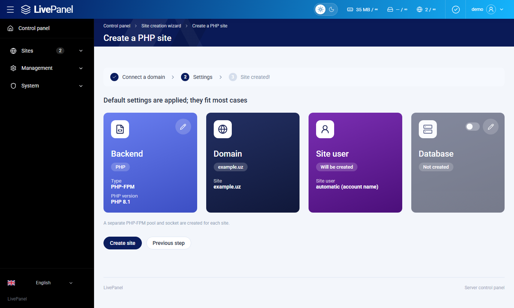

# Создание сайта

Сайт создаётся в три шага **мастера создания сайта**: шаблон → домен → настройки. Его открывает кнопка **«Создать сайт»** на странице **«Сайты»**.

> Домен должен указывать на сервер — до или после создания сайта: у регистратора домена или DNS-провайдера задайте **A-запись домена на IP-адрес сервера**. Этот сервер может быть и DNS-сервером — [Домены и DNS](dns.md).

## Шаг 1: выбор шаблона

| Шаблон | Когда выбирать |
|---|---|
| **PHP** | WordPress, Laravel и другие PHP-сайты. Несколько версий PHP и обработчиков (PHP-FPM, FastCGI, Apache, CGI) |
| **Node.js** | Express, Next.js, NestJS и другие JavaScript-приложения — работают как служба systemd |
| **Python** | Django, Flask, FastAPI и другие Python-приложения — запускаются через Gunicorn |
| **Обратный прокси** | Передача запросов на другой адрес (приложение в Docker-контейнере или на другом сервере) |
| **Статический сайт** | Только файлы HTML, CSS и JavaScript |
| **CMS / Фреймворк** | Готовое приложение, устанавливается вместе с сайтом |

### CMS / Фреймворк

Здесь выбирается платформа (PHP, Node.js, Python), затем вид (**CMS** или **Фреймворк**) и приложение. После создания сайта приложение скачивается и устанавливается автоматически — см. [Установка CMS и фреймворков](app-installer.md).

## Шаг 2: подключение домена

- **Какой домен подключаем?** — домен сайта, например `example.uz`. `www.example.uz` добавляется как псевдоним автоматически.
- **Пользователь сайта** — Linux-пользователь, под которым работает сайт:
  - **Создать нового пользователя** — рекомендуется для каждого нового сайта; сайты изолированы друг от друга.
  - **Существующий пользователь** — сайт использует пользователя ранее созданного сайта (когда нужен общий доступ к файлам).
- **Имя нового пользователя** — если пусто, используется имя аккаунта; это же логин SSH. 3–32 символа: строчные латинские буквы, цифры и `_`, начинается с буквы.
- Администратор или реселлер может создать сайт для другого аккаунта.

**Поддомены.** Если ввести поддомен, например `blog.example.uz`, а `example.uz` уже есть в панели, новый сайт автоматически получит пользователя этого сайта.

Ниже показана папка сайта: `/var/www/<пользователь>/data/www/<домен>`. Сама эта папка и есть точка входа сайта.

## Шаг 3: настройки

Значения по умолчанию подходят в большинстве случаев. Изменить их можно карандашом на карточке:

- **Бэкенд** — версия и обработчик PHP, версия Node.js или Python, адрес прокси.
- **Домен** и **Пользователь сайта** — ваш выбор из шага 2.
- **База данных** — включите, чтобы вместе с сайтом создать базу MySQL или PostgreSQL. Она принадлежит сайту: при удалении сайта удаляется и база.

Нажмите **«Создать сайт»**. Через несколько секунд сайт работает, а в его папке — стартовая страница; замените её своими файлами.

## После создания сайта

1. [Получите SSL-сертификат](ssl.md) — бесплатный Let’s Encrypt в один клик.
2. Загрузите файлы через [файловый менеджер](file-manager.md), [FTP/SFTP](ftp-ssh.md) или [Git](git-deploy.md).
3. При необходимости создайте [базу данных](databases.md) и [почту](mail.md).
4. Включите [автоматическое резервное копирование](backups.md).

> Для Python-сайта на сервере сначала должна быть установлена версия Python (**Система → Приложения**). Если её нет, мастер сообщит об этом, и кнопка «Создать сайт» будет неактивна.
