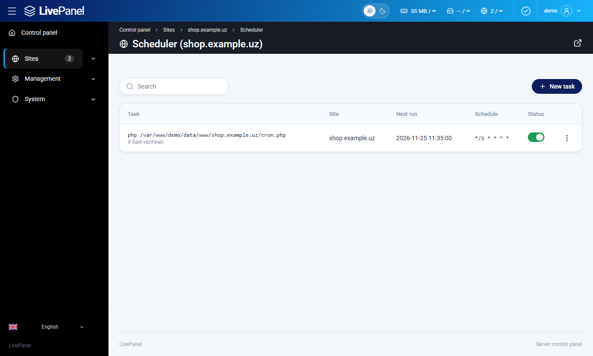

# Планировщик (cron)

Планировщик запускает команды по расписанию: например `cron.php` сайта каждые 5 минут, ежедневный отчёт или очистку кэша.



Откройте плитку **«Планировщик»** на странице сайта. В таблице — команда задачи, сайт, **следующий запуск**, расписание и состояние.

## Добавление задачи

1. Нажмите **«Новая задача»**.
2. **Сайт** — задача выполняется от имени пользователя этого сайта.
3. **Расписание** — выберите вариант: **Каждую минуту**, **Каждый час**, **Каждый день**, **Каждую неделю**, **Каждый месяц** или **Своё**. В «Своё» задаются минута, час, день, месяц и день недели; итоговое **cron-выражение** показано ниже (например `*/5 * * * *`).
4. **Команда** — что запускать. Указывайте полные пути:

   ```bash
   php /var/www/shop/data/www/shop.example.uz/cron.php
   ```

   Для PHP-сайтов используйте путь вида `/usr/bin/php8.3`, чтобы закрепить версию PHP сайта.
5. **Комментарий** — для чего задача.
6. Сохраните.

## Управление задачами

- Переключатель **вкл/выкл** приостанавливает задачу без удаления.
- **«Запустить сейчас»** сразу выполняет команду и показывает результат: код выхода, время выполнения и вывод. Удобно для проверки.
- **Изменить** и **Удалить**.

## Советы

- Laravel: `php /var/www/<пользователь>/data/www/<домен>/artisan schedule:run` — каждую минуту.
- WordPress: сначала добавьте `define('DISABLE_WP_CRON', true);` в `wp-config.php`, затем запускайте `php .../wp-cron.php` каждые 5 минут.
- Вывод запусков по расписанию не хранится; чтобы его сохранять, перенаправьте его в файл: `... >> /var/www/<пользователь>/data/cron.log 2>&1`.
