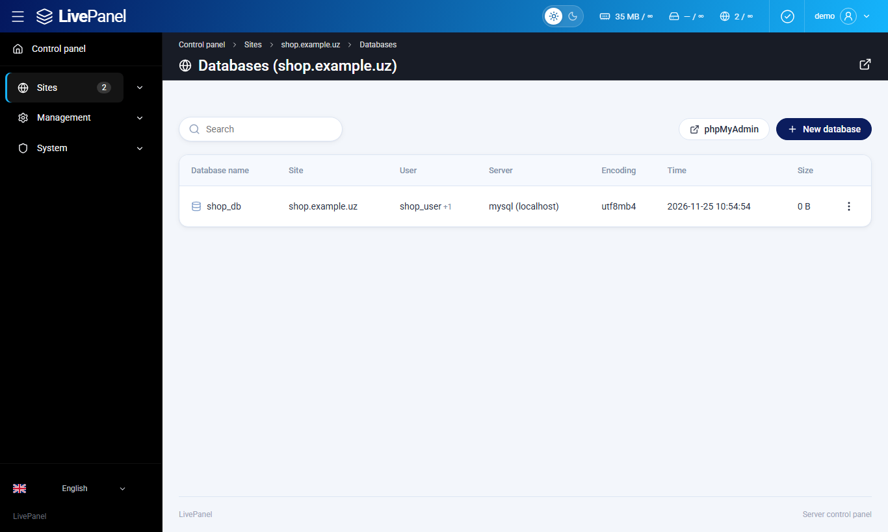
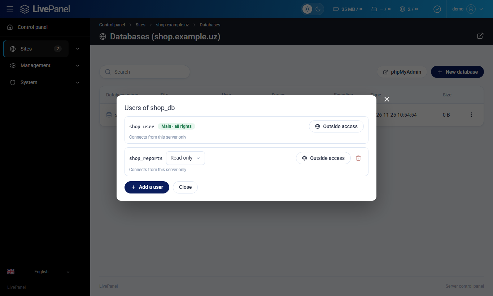

# Базы данных

Панель управляет базами **MySQL 8** (устанавливается вместе с панелью) и **PostgreSQL** (устанавливается в **Система → Приложения**). Каждая база принадлежит одному сайту: при удалении сайта удаляются и его базы.

## Создание базы

1. На странице **«Базы данных»** нажмите **«Новая база»**.
2. **Тип базы** — MySQL или PostgreSQL.
3. **Сайт** — к какому сайту относится база.
4. **Имя базы** и **Пользователь** — строчные латинские буквы, цифры и `_`, до 32 символов.
5. **Пароль** — не менее 8 символов; кнопка **«Сгенерировать»** создаёт надёжный. **Сохраните пароль** — повторно он не показывается.
6. **Кодировка** — `utf8mb4` (рекомендуется).

Параметры для вашего сайта:

| | MySQL | PostgreSQL |
|---|---|---|
| Хост | `localhost` | `127.0.0.1` |
| Порт | 3306 | 5432 |

## phpMyAdmin и Adminer

**«Войти в phpMyAdmin»** в меню строки (для PostgreSQL — **«Открыть в PostgreSQL»**) открывает базу в один клик без пароля — панель создаёт временный вход.

## Меню строки

| Действие | Примечание |
|---|---|
| Сменить пароль | Новый пароль основного пользователя |
| Пользователи и доступ | Дополнительные пользователи и внешний доступ (MySQL) |
| Импорт (.sql) | Загрузить дамп в базу |
| Экспорт (.sql.gz) | Скачать базу сжатым дампом |
| Удалить | База и все её данные удаляются |

## Дополнительные пользователи и права

В окне **«Пользователи и доступ»** — основной пользователь базы (все права) и дополнительные пользователи. К одной базе можно добавить до 20 пользователей.

| Право | Что может |
|---|---|
| **Все права** | Также создавать, изменять и удалять таблицы |
| **Чтение и запись** | Читает, добавляет, изменяет и удаляет данные; не меняет структуру таблиц |
| **Только чтение** | Только чтение — для отчётов и программ резервного копирования |

## Внешний доступ (Remote MySQL)

Обычно к базе подключаются только с этого сервера. Если нужно подключиться из программы на компьютере (DBeaver, HeidiSQL, MySQL Workbench) или с другого сервера:

1. В строке пользователя нажмите **«Внешний доступ»**.
2. **Адреса, которым разрешено подключаться** — по одному IP (`203.0.113.7`) или сети (`198.51.100.0/24`) на строку. `%` — любой адрес (опасно: база открыта всему интернету).
3. При добавлении нового адреса запрашивается **пароль** — он станет паролем этого пользователя везде.
4. Сохраните. Подключение: хост — IP сервера, порт 3306.

Панель открывает MySQL для внешних адресов и **открывает порт 3306 в файрволе только для указанных адресов**. Если список очистить, порт снова закрывается.

## Импорт

1. Выберите **«Импорт (.sql)»** и файл `.sql` или `.sql.gz`.
2. Файл загружается (показывается процент), затем записывается в базу.
3. При ошибке показывается сообщение MySQL/PostgreSQL.

Безопасность: импорт выполняется от имени временного пользователя с правами только на эту базу — команды из файла не затронут другие базы. Строки `DEFINER` из дампов с других серверов удаляются, представления и триггеры переводятся на собственного пользователя базы. Можно импортировать и большие файлы (до 2 ГБ).

## Лимиты

Если у аккаунта есть лимит на число баз, после его достижения новые базы не создаются — [Пользователи, роли и лимиты](users.md).
