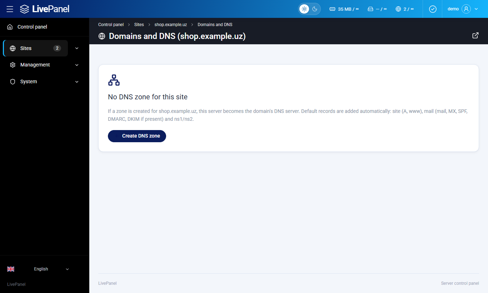
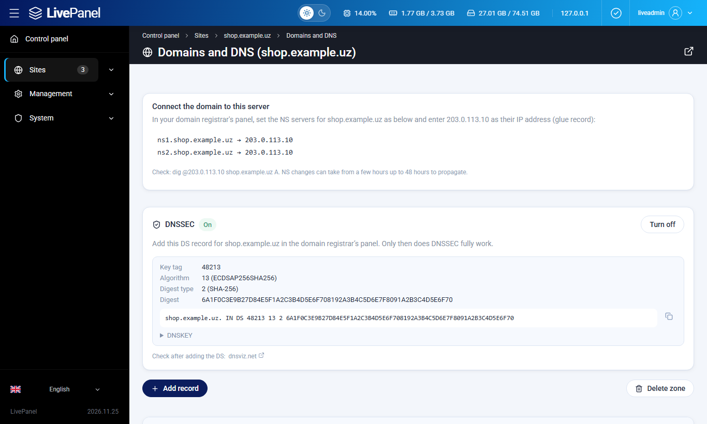

# Домены и DNS

Чтобы сайт открывался, его домен должен указывать на IP-адрес сервера. Есть два способа:

1. **У регистратора домена или внешнего DNS-провайдера** (например Cloudflare) добавить A-запись — самый простой способ.
2. **Сделать этот сервер DNS-сервером домена** — в панели создаётся DNS-зона, и все записи управляются из неё.

## Способ 1: A-запись

В настройках DNS у регистратора добавьте:

| Имя | Тип | Значение |
|---|---|---|
| `@` | A | IP-адрес сервера |
| `www` | A | IP-адрес сервера |

Для почты нужны ещё записи MX, SPF, DKIM и DMARC — их показывает раздел **«Почта»**: [Почта](mail.md).

## Способ 2: DNS-зона в панели

Должен быть установлен DNS-сервер (BIND) — **Система → Приложения** → `bind9`.

1. Откройте плитку **«Домены и DNS»** на странице сайта.
2. Нажмите **«Создать DNS-зону»**. Стандартные записи добавляются автоматически:
   - `A` для сайта (`@` и `www`);
   - `mail`, `MX`, `SPF`, `DMARC` для почты (и `DKIM`, если почта включена);
   - `ns1` и `ns2`.
3. У регистратора домена укажите **NS-серверы** домена `ns1.<домен>` и `ns2.<домен>` и введите IP сервера как их адрес (**glue-запись**). Точные значения панель показывает на странице.
4. Изменения NS расходятся от нескольких часов до 48 часов. Проверка: `dig NS example.uz`.

## Управление записями

**«Добавить запись»**, изменение и удаление — через меню строки. У каждой записи есть **Имя**, **Тип**, **Значение**, **TTL** и при необходимости **Приоритет**.

| Тип | Назначение |
|---|---|
| A | Имя → IPv4-адрес. `@` — сам домен, `www` — www.домен |
| AAAA | Имя → IPv6-адрес |
| CNAME | Имя — псевдоним другого имени. Нельзя на самом домене (`@`); точка в конце означает полное имя |
| MX | Почтовый сервер; сначала пробуется меньший приоритет |
| TXT | SPF, DKIM, DMARC, коды подтверждения домена |
| NS | DNS-серверы домена или поддомена |
| SRV | Расположение службы: `вес порт цель` |
| CAA | Какие центры могут выдавать SSL, например `0 issue "letsencrypt.org"` |

**Серийный номер** зоны растёт при каждом сохранении. **«Удалить зону»** удаляет зону полностью — если домен использует этот сервер через NS, он перестанет открываться.

## DNSSEC

DNSSEC подписывает ответы зоны: резолверы проверяют, что ответ действительно пришёл с этого сервера, и подделать DNS-ответ не получится.

1. На странице зоны в карточке **DNSSEC** нажмите **Включить DNSSEC**. BIND сам создаёт ключ (ECDSA P-256) и подписывает зону. Каждое изменение тоже подписывается автоматически.
2. Через несколько секунд в карточке появится **DS-запись**: Key tag, Алгоритм (13), Тип дайджеста (2, SHA-256) и Дайджест.
3. Добавьте эту DS-запись в панели регистратора домена (раздел DNSSEC). Некоторые регистраторы просят DNSKEY — он тоже есть в карточке.
4. Через несколько часов проверьте на [dnsviz.net](https://dnsviz.net).

**Перед выключением** удалите DS-запись у регистратора и подождите несколько часов. Иначе резолверы отклонят неподписанные ответы, и домен перестанет открываться.
