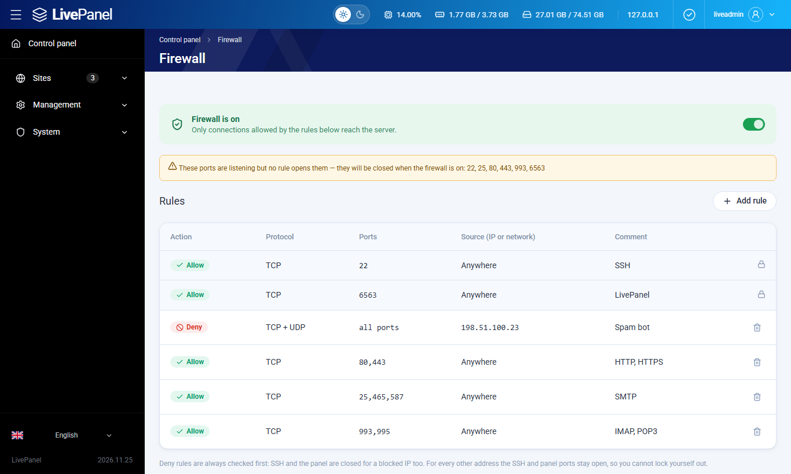

# Файрвол

**Система → Файрвол** (для администратора) определяет, к каким портам сервера и откуда можно подключаться. Панель управляет правилами nftables.

## Включение

Сначала файрвол выключен — сервер открыт на всех портах. Когда переключатель вверху включён, до сервера доходят только соединения, разрешённые правилами.

Панель предупреждает:
- о **портах, которые слушаются, но не открыты ни одним правилом** — при включении файрвола они закроются;
- если на сервере включён и **ufw** — оба файрвола работают вместе, и соединение проходит, только если его разрешают оба.

## Правила

У каждого правила:

| Поле | Значение |
|---|---|
| **Действие** | **Разрешить** или **Запретить** |
| **Протокол** | TCP, UDP или оба |
| **Порты** | один (`8080`), список (`80,443`) или диапазон (`3000-3010`); пусто — все порты |
| **Источник** | IP или сеть (`198.51.100.0/24`); пусто — отовсюду |
| **Комментарий** | для чего правило |

Стандартные правила: HTTP/HTTPS (80, 443) и, если установлены, FTP, SMTP, IMAP/POP3.

- Правила **«Запретить»** всегда проверяются первыми. Для запрета нужен источник; без портов источник блокируется полностью.
- Правила для **SSH и порта панели** — системные и не удаляются, поэтому вы не потеряете доступ к серверу.
- Если включён внешний доступ к базе, для порта 3306 и указанных адресов автоматически добавляется системное правило — [Базы данных](databases.md).

## Сохранение и безопасность

**«Сохранить и применить»** сразу применяет правила. Если после применения панель в течение минуты не может подтвердить связь с вашим браузером (например, вы заблокировали себя), **прежние правила восстанавливаются автоматически**.

Правила сохраняются и после перезагрузки сервера.

> У провайдера может быть и внешний файрвол (в облачной панели) — правила панели работают уже за ним.
