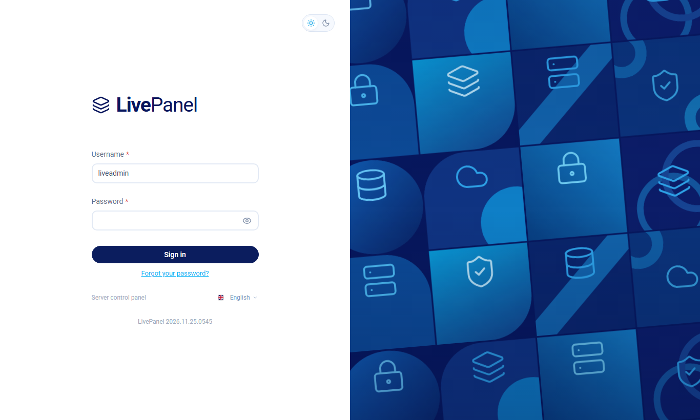
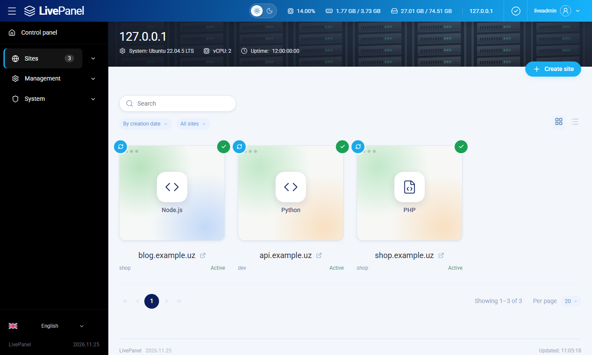
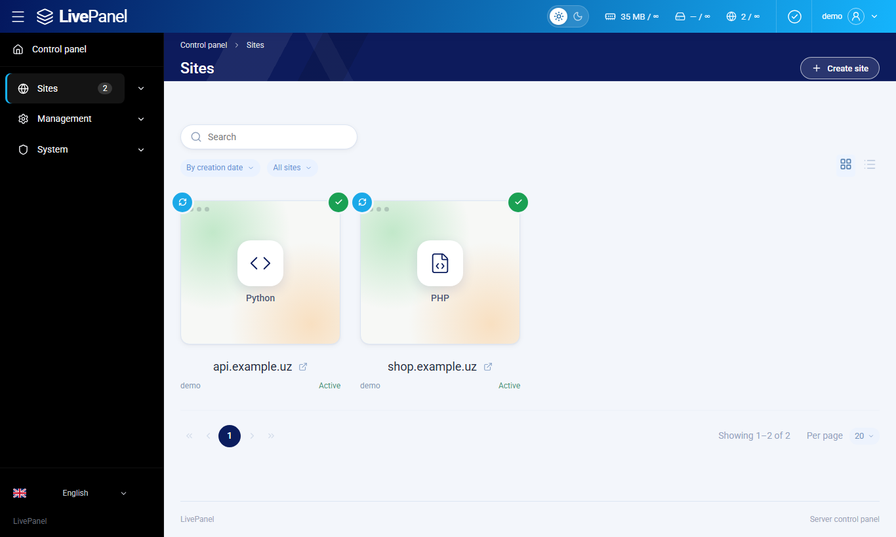

# Первый вход и интерфейс

## Страница входа

Введите логин и пароль на `https://SERVER_IP:6563`. Меню справа внизу выбирает язык панели, кнопка сверху переключает светлую и тёмную тему.

- **«Забыли пароль?»** — если у аккаунта указан email для восстановления, на него придёт ссылка для нового пароля (действует 30 минут).
- После нескольких неверных паролей IP-адрес блокируется на время — [Настройки и безопасность панели](panel-settings.md).
- Если включён двухфакторный вход (2FA), после пароля запрашивается 6-значный код из приложения.

## После первого входа

1. **Активируйте лицензию** — без неё панель не работает; тариф Free бесплатный. [Лицензия и тарифы](license.md).
2. **Укажите email для восстановления** — панель спросит его при первом входе. Он нужен, если вы забудете пароль.
3. **Смените пароль** и **включите 2FA** — **Настройки → Безопасность** и **Двухфакторный вход**.

## Устройство панели

**Верхняя панель:**
- загрузка процессора, памяти и диска и IP-адрес сервера (для администратора);
- у обычного пользователя — его лимиты: использованные RAM и диск, количество сайтов;
- переключатель темы и меню аккаунта (настройки, выход).

**Левое меню:**

| Раздел | Содержимое |
|---|---|
| **Панель управления** | Состояние сервера и карточки сайтов |
| **Сайты** | Список сайтов, новый сайт, разделы каждого сайта |
| **Управление** | Файлы, базы данных, SSL, DNS, почта, FTP, cron, резервные копии |
| **Система** | Пользователи, приложения, службы, файрвол, статистика, терминал, журнал действий, лицензия |

Меню зависит от роли аккаунта: обычный пользователь не видит настроек сервера — [Пользователи, роли и лимиты](users.md).

## Страница «Сайты»

Карточка сайта показывает его вид (снимок), домен, владельца и состояние. Нажмите на карточку, чтобы открыть страницу сайта — [Управление сайтом](site-management.md). Кнопка **«Создать сайт»** справа вверху открывает мастер создания сайта — [Создание сайта](create-site.md).

Можно переключаться между карточками и таблицей, искать и сортировать сайты.
