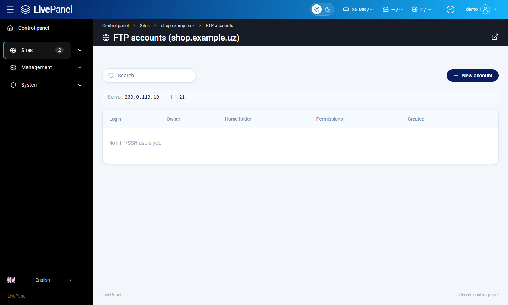

# FTP, SFTP и SSH

Чтобы загружать файлы через FileZilla, WinSCP и подобные программы, создайте FTP-аккаунт. Для командной строки используйте SSH.

## FTP-аккаунты



Откройте плитку **«FTP-аккаунты»** на странице сайта. Вверху страницы — данные для подключения: адрес сервера и порт FTP (21).

### Создание аккаунта

1. Нажмите **«Новый аккаунт»**.
2. **Логин** — строчные латинские буквы, цифры, `_` и `-`; начинается с буквы (3–32 символа).
3. **Сайт** — аккаунт работает от имени владельца этого сайта.
4. **Домашняя папка** — аккаунт видит только её. Это должна быть папка сайта или папка внутри неё.
5. **Права** — **«Полный доступ»** или **«Только чтение»**.
6. Введите или сгенерируйте пароль и сохраните.

Позже аккаунт можно изменить, сменить ему пароль, временно отключить или удалить. Удаление аккаунта не удаляет файлы сайта.

### Подключение

| | Значение |
|---|---|
| Хост | IP-адрес или домен сервера |
| Протокол | FTP (порт 21, пассивный режим) |
| Логин / пароль | созданный аккаунт |

Файлы, загруженные по FTP, принадлежат владельцу сайта — сайт читает их без проблем.

## SFTP и SSH

SSH выдаётся аккаунту панели: администратор включает **«Разрешить вход по SSH»** в настройках аккаунта в разделе **Система → Пользователи**. Тогда:

- **Логин** — Linux-пользователь сайтов аккаунта (в списке пользователей он показан как логин SSH);
- **Пароль** — тот же, что и пароль панели;
- **Порт** — SSH-порт сервера (обычно 22).

```bash
ssh shop@SERVER_IP
```

Для SFTP выберите протокол **SFTP** в FileZilla или WinSCP; подходят те же логин и пароль.

> Пользователь SSH работает в изолированной среде: видит только свою домашнюю папку и не может выйти из неё. Для работы со всем сервером администратор использует [Терминал](terminal.md) панели от root.

Многократные неверные пароли блокируются fail2ban — [Настройки и безопасность панели](panel-settings.md).
