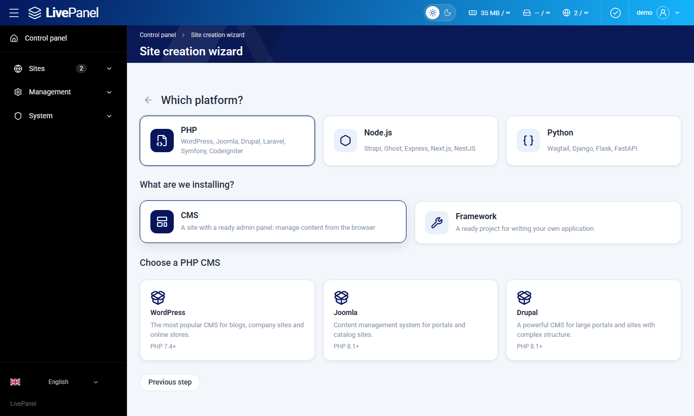

# Сайт на WordPress: с нуля до HTTPS

В этом руководстве откроем сайт на WordPress на вашем домене: сайт, WordPress, SSL, почта и автоматические резервные копии. Около 10 минут.

**Понадобится:** сервер с LivePanel, домен (например `example.uz`) и доступ к его DNS.

## 1. Направьте домен на сервер

В панели регистратора домена добавьте две A-записи:

| Имя | Тип | Значение |
|---|---|---|
| `@` | A | IP-адрес сервера |
| `www` | A | IP-адрес сервера |

DNS расходится от нескольких минут до нескольких часов. Проверка: `nslookup example.uz` должен показывать IP сервера. Подробнее — [Домены и DNS](dns.md).

## 2. Создайте сайт и WordPress

1. **Сайты → «Создать сайт»**.
2. Шаблон: **CMS / Фреймворк → PHP → CMS → WordPress**.
3. Домен: `example.uz`. Пользователь сайта — **новый пользователь**.
4. На шаге настроек введите для WordPress **название сайта**, **логин**, **email** и **пароль администратора** (не менее 12 символов; панель предложит готовый). Версию PHP оставьте или выберите новейшую.
5. Нажмите **«Создать сайт»**.

Панель скачает WordPress, создаст базу MySQL и настроит `wp-config.php`. В конце будут ссылка на админку (`https://example.uz/wp-admin/`) и данные базы — сохраните их. Подробнее — [Установка CMS и фреймворков](app-installer.md).

## 3. Получите SSL-сертификат

1. На странице сайта — **«SSL-сертификаты» → «Новый сертификат»**.
2. Выберите **Let’s Encrypt** и включите **«Перенаправлять все HTTP-запросы на HTTPS»**.

Сайт теперь открывается по `https://example.uz`. В WordPress в **Настройки → Общие** проверьте, что оба адреса начинаются с `https://`. Подробнее — [SSL-сертификаты](ssl.md).

## 4. Почта (по желанию)

Для адреса вида `info@example.uz` — **Почта → «Новый домен»**, затем создайте ящик и добавьте DNS-записи (MX, SPF, DKIM, DMARC). Подробнее — [Почта](mail.md).

Чтобы письма WordPress (сброс пароля, заказы) доходили, укажите этот ящик в SMTP-плагине: сервер — адрес почтового сервера, порт 587, STARTTLS.

## 5. Автоматические резервные копии

1. На странице сайта — **«Резервные копии»**.
2. **Автоматическое копирование → Каждый день**, хранить копий — 7, отмечены **Файлы** и **Базы данных**.
3. По возможности подключите Google Drive или Dropbox в **Настройки → Серверы резервных копий** и включите отправку для сайта.

Подробнее — [Резервные копии](backups.md).

## 6. Скорость и безопасность

- **Настоящий cron вместо WP-Cron:** добавьте `define('DISABLE_WP_CRON', true);` в `wp-config.php` и задание каждые 5 минут в [Планировщике](cron.md): `php /var/www/<пользователь>/data/www/example.uz/wp-cron.php`.
- **Кэш:** установите Redis в **Система → Приложения** и используйте плагин Redis Object Cache.
- **Большие картинки и плагины:** увеличьте `upload_max_filesize` и `post_max_size` в **Настройки → Бэкенд → Настройки PHP**.
- **Защита админки:** [Защита входа](panel-settings.md) и **лимит частоты запросов** сайта снижают подбор паролей к `wp-admin`; обновляйте WordPress, плагины и темы.
- **Проверка на вирусы:** время от времени пользуйтесь плиткой **«Сканирование»** — [Безопасность и сканирование сайта](site-security.md).
