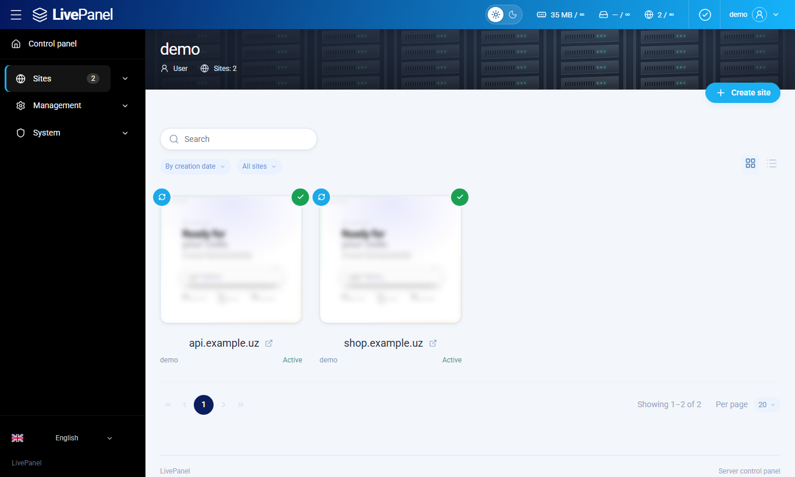

# Что такое LivePanel

**LivePanel** — панель управления хостингом: через браузер вы управляете Linux-сервером и сайтами на нём. Панель устанавливается на сервер и собирает в одном месте сайты, базы данных, почту, SSL-сертификаты, резервные копии и сам сервер — без командной строки.

> На снимках панель показана на английском. Язык панели можно сменить в любой момент в меню слева внизу (узбекский, русский или английский).

## Возможности

| Раздел | Функции |
|---|---|
| Сайты | PHP (5.6–8.6), Node.js, Python, статические сайты и обратный прокси; мастер создания сайта; поддомены; смена типа бэкенда позже |
| Приложения | WordPress, Joomla, Drupal, Laravel, Symfony, CodeIgniter, Strapi, Ghost, Express, Next.js, NestJS, Wagtail, Django, Flask, FastAPI — в один клик |
| Разработка | Деплой из Git (автоматически по вебхуку), переменные окружения, службы и логи сайта, веб-терминал |
| Данные | MySQL 8 и PostgreSQL, phpMyAdmin и Adminer без пароля, импорт/экспорт, дополнительные пользователи и внешний доступ |
| Безопасность | Бесплатный SSL Let’s Encrypt, файрвол, защита входа и fail2ban, двухфакторный вход (2FA), закрытие сайта по IP, антивирус ClamAV |
| Почта | Почтовые домены, ящики, пересылки, DKIM, веб-почта Roundcube |
| Резервные копии | Копии по расписанию, восстановление в один клик, отправка в Google Drive и Dropbox |
| Администрирование | Пользователи и реселлеры, лимиты диска/RAM/доменов, статистика и трафик, брендинг, API, автообновления |

## Для кого

- **Разработчики и компании со своим сервером** — установите панель на VPS и управляйте сайтами сами.
- **Хостинг-провайдеры** — отдельные аккаунты для клиентов с лимитами и вашим брендом (реселлеры).
- **Агентства** — каждый клиентский сайт работает под своим Linux-пользователем, изолированно от остальных.

## Как это устроено

- Панель на сервере состоит из двух частей: веб-интерфейса (порт 6563) и агента с правами root. Агент работает только через сокет внутри сервера и недоступен снаружи.
- Каждый сайт работает **под своим Linux-пользователем**: его пул PHP-FPM, служба Node.js/Python, задания cron и файлы принадлежат этому пользователю. Если один сайт взломают, остальные не пострадают.
- Веб-сервер — **Nginx**. PHP работает через PHP-FPM (или FastCGI, Apache, CGI); приложения Node.js и Python — как службы systemd.
- Лицензия панели выдаётся на livepanel.uz. Тариф **Free** бесплатный и бессрочный.

## Что дальше

1. [Установка](installation.md) — установка на сервер одной командой.
2. [Первый вход и интерфейс](first-login.md) — знакомство с панелью.
3. [Создание сайта](create-site.md) — запуск первого сайта.
