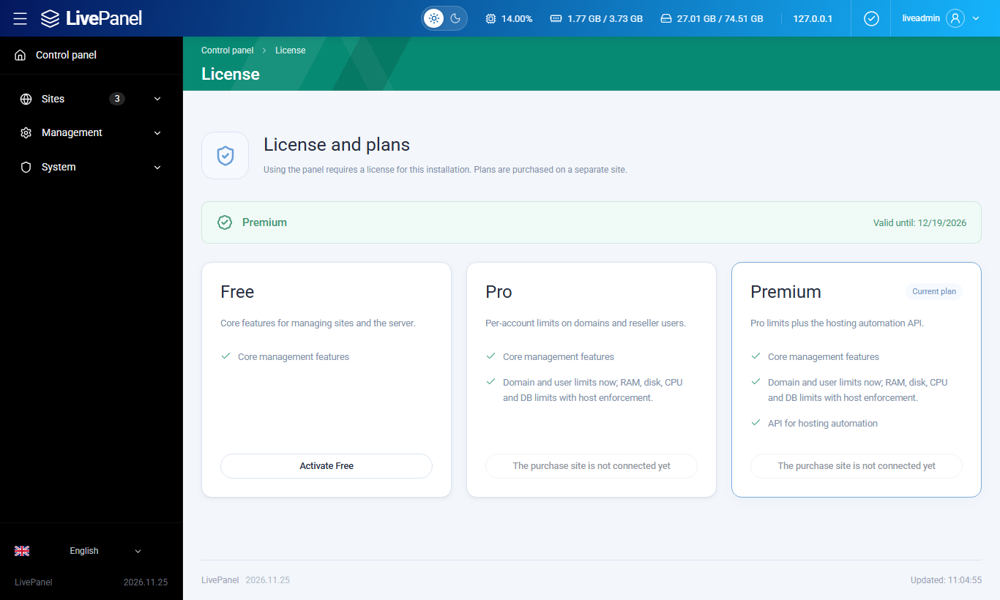

# Лицензия и тарифы

Для работы панели нужна лицензия. Лицензии выдаются на livepanel.uz и **привязываются к IP-адресу сервера**.

## Тарифы

| | Free | Pro | Premium |
|---|---|---|---|
| Цена | Бесплатно, бессрочно | Ежемесячно | Ежемесячно |
| Сайты, базы, почта, SSL, резервные копии, Git и все основные функции | ✅ | ✅ | ✅ |
| Лимиты аккаунтов: домены, диск, RAM, базы, пользователи реселлера | — | ✅ | ✅ |
| API автоматизации хостинга (токены) | — | — | ✅ |
| Wildcard SSL-сертификат (`*.домен`) | — | — | ✅ |
| Кеш страниц, изображения WebP/AVIF, свой Redis для сайта, блокировка по странам | — | ✅ | ✅ |
| Режим атаки (защита от L7-атак) | — | — | ✅ |

Актуальные цены: [livepanel.uz](https://livepanel.uz) → **Тарифы**.

## Активация бесплатной лицензии

1. В панели откройте **Система → Лицензия**.
2. На карточке **Free** нажмите **«Активировать Free»**.
3. Откроется страница livepanel.uz: войдите (или зарегистрируйтесь) и подтвердите.
4. Лицензия автоматически передаётся в панель — обновите страницу панели.

## Покупка Pro или Premium

1. На странице **Система → Лицензия** нажмите на карточку нужного тарифа.
2. Откроется страница оплаты на livepanel.uz с уже указанным адресом сервера.
3. После оплаты лицензия **устанавливается в панель автоматически** — ключ вводить не нужно. Панель также сама получит её в течение нескольких минут.

Лицензию можно смотреть, продлевать и управлять ею в разделе **Ключи** личного кабинета livepanel.uz.

## Как защищены ключи лицензии

- **Ввода ключа или активации по коду нет.** Платная лицензия после оплаты сама приходит в панель с livepanel.uz; панель также сама запрашивает её в течение нескольких минут. Кнопка в панели активирует только тариф **Free**.
- **Младший тариф не заменяет старший.** Если в панели активен Premium, ключ Free или Pro не может его заменить (панель ответит «У панели уже есть лицензия лучше»). Для одного тарифа остаётся ключ с более долгим сроком.
- **Ключ выдаётся только своему серверу.** livepanel.uz отдаёт ключ только на IP-адрес сервера, к которому привязана лицензия, или на адрес сервера, указанный при покупке. Знания ID установки для получения ключа недостаточно.

## Когда срок заканчивается

- За 5 дней до окончания в кабинете появляется предупреждение.
- После окончания срока функции панели временно останавливаются, **но сайты продолжают работать**.
- Для продления нажмите **«Продлить»** на странице **«Лицензия»**. После оплаты **«Проверить снова»** сразу получит новый ключ.

## Перенос на другой сервер

Лицензия привязана к одному IP-адресу. Если вы переносите панель на другой сервер, **перенесите** лицензию в разделе **Ключи** кабинета livepanel.uz. Если старый сервер не выходил на связь больше 24 часов, лицензия переходит на новый сервер сама.

> Если панель пишет «Лицензия привязана к другому серверу» — это как раз этот случай: нажмите кнопку переноса в кабинете.
