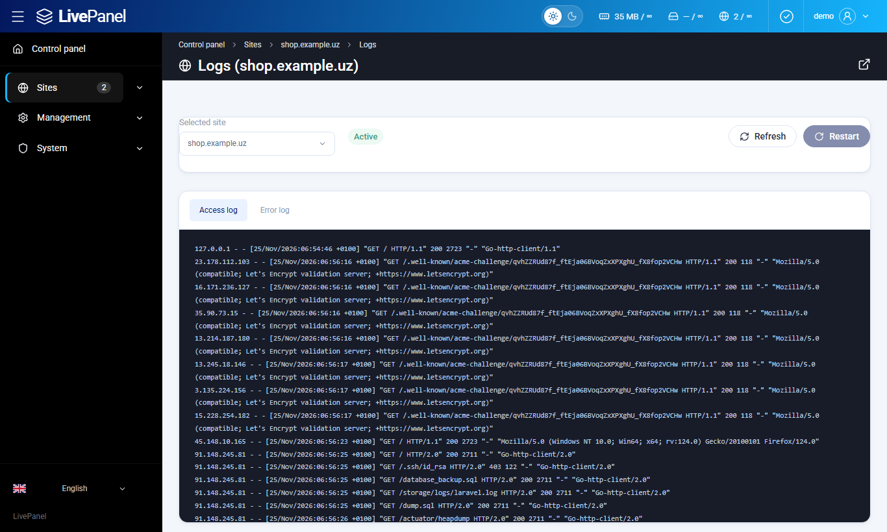

# Логи

Логи показывают запросы к сайту и ошибки — первое место, куда смотреть, если сайт перестал работать. Откройте их плиткой **«Логи»** на странице сайта (у аккаунта должно быть право **«Службы и логи сайтов»**).

## Виды логов

| Вкладка | Что показывает |
|---|---|
| **Журнал запросов** | Каждый запрос к сайту: IP-адрес, время, страница, код ответа, размер, браузер |
| **Журнал ошибок** | Ошибки Nginx и PHP: отсутствующие файлы, ошибки прав, фатальные ошибки PHP |
| **Лог приложения** | Для сайтов Node.js и Python — вывод самого приложения (журнал systemd); здесь ошибки запуска |

Показываются последние записи. **«Обновить»** загружает лог заново.

## Перезапуск службы

Вверху показаны служба сайта и её состояние (например, **Активна**). Кнопка **«Перезапустить»**:

- на PHP-сайте перезагружает пул PHP-FPM сайта;
- на сайте Node.js или Python перезапускает службу приложения — нажимайте её после изменения кода.

## Коды ответа

| Код | Значение |
|---|---|
| 200 | Запрос выполнен |
| 301 / 302 | Перенаправление |
| 403 | Доступ запрещён — сайт отключён, IP заблокирован или в папке нет главной страницы |
| 404 | Файл не найден |
| 500 | Ошибка приложения — смотрите **Журнал ошибок** или **Лог приложения** |
| 502 | Приложение не работает или не отвечает — смотрите **Лог приложения** |
| 504 | Приложение слишком долго отвечало |

Запись логов можно выключить в настройках сайта — [Настройки сайта](site-settings.md). Если журнал доступа выключен, статистика трафика не считается.
