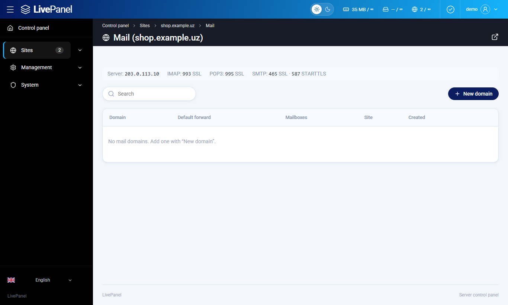

# Почта

Панель настраивает почтовый сервер для вашего домена: ящики вида `info@example.uz`, пересылки, подпись DKIM, чтобы письма не попадали в спам, и веб-почту **Roundcube** для браузера. Почтовый сервер (Exim и Dovecot) устанавливается автоматически при добавлении первого домена — это может занять 2–5 минут.

Вверху страницы — данные для подключения: адрес сервера, IMAP (993, SSL), POP3 (995, SSL), SMTP (465 SSL и 587 STARTTLS).

## 1. Добавьте почтовый домен

1. Нажмите **«Новый домен»**.
2. **Домен** — почтовые адреса будут на этом домене (`info@домен`). Он может отличаться от имени сайта.
3. **Сайт** — к какому сайту относится домен.
4. Сохраните. Для домена создаётся ключ DKIM.

В настройках домена:
- **Пересылка по умолчанию** (catch-all) — письма на несуществующие адреса уходят на этот адрес; если пусто — отклоняются;
- переключатель **«Почта включена»** — если выключен, домен не принимает письма.

## 2. Добавьте DNS-записи

Чтобы письма доходили и не попадали в спам, в DNS домена должны быть эти записи. Точные значения панель показывает в окне **«DNS-записи»**:

| Запись | Назначение |
|---|---|
| `MX` | Почта домена приходит на этот сервер |
| `A` (`mail`) | Адрес почтового сервера |
| `TXT` SPF | Этому серверу разрешено отправлять письма от имени домена |
| `TXT` DKIM | Подпись писем |
| `TXT` DMARC | Что делать с письмами, не прошедшими SPF/DKIM |

Если DNS-зона на этом сервере, записи добавляются автоматически — [Домены и DNS](dns.md).

## 3. Создайте почтовый ящик

1. Выберите домен и нажмите **«Новый ящик»**.
2. **Логин** — часть адреса до `@` (`info`).
3. **Пароль** — надёжный пароль; панель показывает его стойкость и может сгенерировать.
4. **Псевдонимы** — дополнительные имена, которые приходят в этот ящик, по одному на строку (`sales` → `sales@домен`).
5. **Пересылки** — копия каждого письма отправляется и на эти адреса (в ящике тоже остаётся).
6. **Квота (МБ)** — размер ящика; 0 — без ограничений.

Ящик можно временно отключить — вход и приём писем прекращаются.

## Настройка почтовых программ

В Outlook, Thunderbird или почтовом приложении телефона:

| | Сервер | Порт | Шифрование |
|---|---|---|---|
| Входящая (IMAP) | адрес сервера | 993 | SSL/TLS |
| Входящая (POP3) | адрес сервера | 995 | SSL/TLS |
| Исходящая (SMTP) | адрес сервера | 465 или 587 | SSL/TLS или STARTTLS |

Логин — полный адрес (`info@example.uz`), пароль — пароль ящика.

## Веб-почта

Если установлен **Roundcube** (**Система → Приложения** → `roundcube`), почта открывается в браузере по адресу `https://SERVER:6563/webmail/`. Ссылка **«Веб-почта (Roundcube)»** на странице ведёт туда же.

## Если письма не отправляются

- Многие VPS-провайдеры **закрывают исходящий порт 25** против спама. Панель предупреждает, если обнаружит это: приём работает, но письма на внешние почты (Gmail и др.) не уходят. Попросите провайдера открыть порт.
- Если письма попадают в спам — проверьте записи SPF, DKIM и DMARC и что **PTR-запись (обратный DNS)** сервера указывает на `mail.домен` (PTR настраивается у провайдера).
