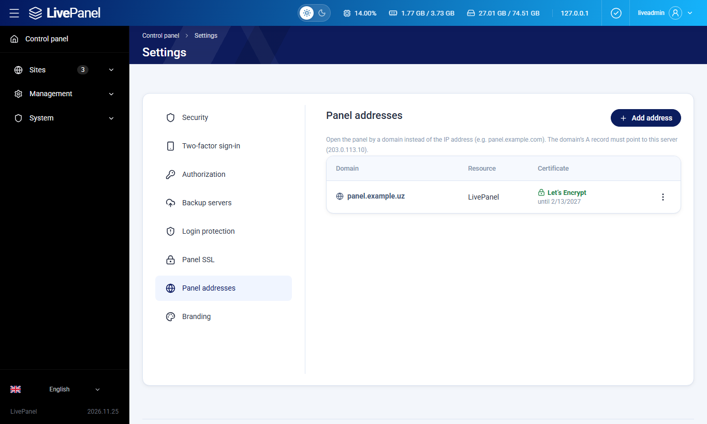
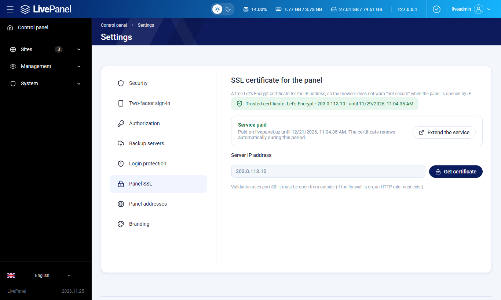

# Адрес панели и SSL

Сначала панель открывается по адресу `https://SERVER_IP:6563` с собственным (самоподписанным) сертификатом, и браузер предупреждает «небезопасно». Исправить это можно двумя способами.

## 1. Адреса панели: вход по домену

**Настройки → Адреса панели** (для администратора) — открывать панель по домену вместо IP, например `https://panel.example.uz`.

1. Направьте **A-запись** домена на IP-адрес сервера.
2. Нажмите **«Добавить адрес»** и введите домен.
3. **Тип сертификата**:
   - **Let’s Encrypt** — бесплатный доверенный сертификат, продлевается автоматически;
   - **Самоподписанный**;
   - **Существующий сертификат** — вставьте свой сертификат и закрытый ключ (PEM).
4. Сохраните. Теперь панель открывается по `https://panel.example.uz` (порт указывать не нужно).

Если Let’s Encrypt не выдаст сертификат, временно ставится самоподписанный, и показывается причина.

### Доступ по IP

Если выключить переключатель **Доступ по IP** под таблицей адресов, порт 6563 закрывается снаружи и панель открывается только через свои адреса. Доступ с самого сервера (`127.0.0.1`) остаётся открытым.

- Переключатель работает, когда добавлен адрес с сертификатом Let’s Encrypt или своим.
- Чтобы выключить его, откройте панель через её адрес (например `https://panel.example.uz`) — на странице, открытой по IP, переключатель неактивен.
- Если такого адреса не остаётся (удалён или его сертификат заменён на самоподписанный), доступ по IP включается сам.
- Если адрес перестал работать, на сервере по SSH: `livepanel ip-access on` — [Команды сервера](console.md).

## 2. SSL панели: сертификат на IP-адрес

**Настройки → SSL панели** — панель открывается по IP-адресу с доверенным сертификатом даже без домена. Сертификат выдаёт Let’s Encrypt на IP-адрес.

- Это платная услуга livepanel.uz (ежемесячно). Кнопка **«Купить на livepanel.uz»** открывает страницу оплаты.
- После оплаты нажмите **«Получить сертификат»** — панель перейдёт на новый сертификат в течение 30 секунд.
- Сертификаты для IP краткосрочные (~6 дней): пока услуга оплачена, панель продлевает их сама. Если услуга закончится, панель вернётся к собственному сертификату и продолжит открываться.
- Проверка идёт через порт 80 — он должен быть открыт снаружи.

## Порт панели

Панель работает на порту 6563. Этот порт должен быть открыт во внешнем файрволе провайдера. При использовании адресов панели она открывается и через порт 443. При выключенном **доступе по IP** панель открывается только так.
