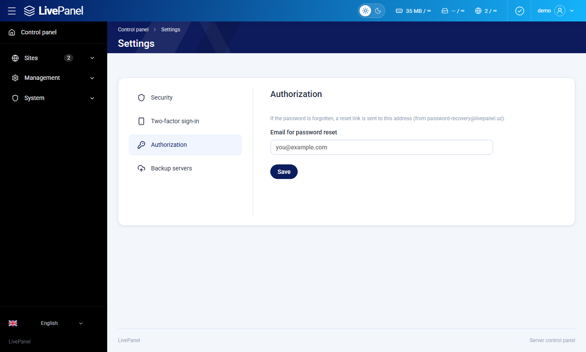

# Настройки и безопасность панели

На странице **«Настройки»** в меню аккаунта настраивается безопасность панели и аккаунта. Набор разделов зависит от роли.

## Безопасность: смена пароля

Введите **текущий пароль** и **новый пароль** (6–72 символа). После сохранения войдите в панель заново с новым паролем.

## Двухфакторный вход (2FA)

Помимо пароля запрашивается 6-значный код из приложения на телефоне (Google Authenticator, Microsoft Authenticator, Aegis и др.). Даже если пароль украдут, войти в аккаунт не получится.

1. Нажмите **«Включить 2FA»**.
2. Отсканируйте QR-код в приложении (или введите секретный ключ вручную).
3. Введите код из приложения и нажмите **«Подтвердить и включить»**.
4. **Сохраните резервные коды** — если потеряете телефон, войдёте с одним из них (каждый действует один раз; повторно не показываются).

Для пользователя, потерявшего и телефон, и коды, администратор выключает 2FA в разделе **«Пользователи»**.

## Авторизация: email для восстановления

**Email для сброса пароля** — если пароль забыт, «Забыли пароль?» на странице входа отправит на этот адрес ссылку для сброса (от password-recovery@livepanel.uz, действует 30 минут). На этот же адрес приходят уведомления панели.

## Защита входа (администратор)

IP-адрес блокируется, если за указанное время с него столько раз ввели неверный пароль. Лимит действует для панели, SSH, FTP и почты (через fail2ban).

- **Число попыток**, **Интервал (минут)**, **Срок блокировки (минут)**.
- **Белый список** — IP, которые никогда не блокируются; добавьте себя кнопкой **«Добавить мой IP-адрес»**.
- **Заблокированные IP-адреса** — с указанием службы, где произошла блокировка; **«Разблокировать»**.
- **Защищённые службы (fail2ban)** — ошибки и блокировки по каждой службе. Если fail2ban не установлен, установите его в разделе **«Приложения»**.

## Брендинг (администратор и реселлер)

- **Название панели** (до 40 символов), **Основной цвет** и **Логотип** (PNG, JPEG, WebP или GIF, до 1 МБ).
- Бренд администратора — бренд по умолчанию для всей панели: виден на странице входа и у реселлеров без своего бренда.
- Бренд реселлера видят созданные им пользователи.
- **«Сбросить по умолчанию»** возвращает вид LivePanel.

## Другие разделы

- **Серверы резервных копий** — Google Drive и Dropbox: [Резервные копии](backups.md).
- **SSL панели** и **Адреса панели** — [Адрес панели и SSL](panel-access.md).
- **Автообновление** — автоматический приём обновлений (по умолчанию выключен) и кнопка **Обновить**: [Обновления и уведомления](updates-notifications.md).
