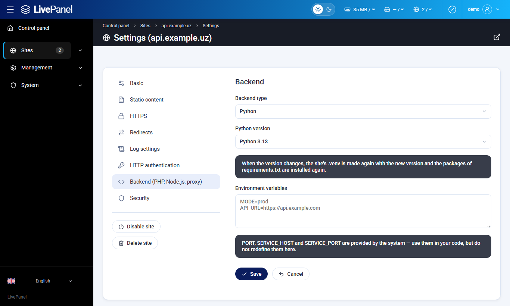

# Сайты на Python и Node.js

Сайты Node.js и Python работают иначе, чем PHP: приложение работает постоянно как **служба systemd** от имени пользователя сайта и слушает внутренний порт, а Nginx передаёт ему запросы домена. Служба сама запускается при перезагрузке сервера и перезапускается, если остановилась.

## Версии

- **Node.js** — вместе с панелью устанавливается Node.js LTS. Другие версии (16–26) ставятся в **Система → Приложения**.
- **Python** — вместе с панелью не устанавливается: поставьте нужную версию (3.11, 3.12, 3.13, 3.14, 3.15) в **Система → Приложения**. Версии берутся из официальных сборок python-build-standalone и не затрагивают системный Python.

Версию сайта потом можно сменить в **Настройки → Бэкенд**.

## Сайт на Node.js

В папке сайта лежит **`app.js`** — служба запускает именно этот файл командой `node app.js`. Ваше приложение:

- должно брать порт из `process.env.PORT` и слушать `127.0.0.1`:

  ```js
  const express = require("express");
  const app = express();
  app.get("/", (req, res) => res.send("Привет!"));
  app.listen(Number(process.env.PORT), "127.0.0.1");
  ```

- если проект в другом файле, подключите его из `app.js`: `require("./server.js")` или `import("./dist/main.js")`.

Пакеты: выполните `npm install` в папке сайта по SSH или в [Терминале](terminal.md), либо добавьте в команду [деплоя из Git](git-deploy.md).

## Сайт на Python



В папке сайта:

| Файл | Назначение |
|---|---|
| `app.py` | Стартовое WSGI-приложение (объект `application`) |
| `gunicorn.conf.py` | Настройки Gunicorn: какое приложение запускать (`wsgi_app`), число воркеров, класс воркера |
| `.venv/` | Собственное виртуальное окружение Python сайта, Gunicorn здесь |
| `requirements.txt` | Пакеты проекта (необязательно) |

Служба запускает `.venv/bin/gunicorn --config gunicorn.conf.py`. Чтобы подключить свой проект, измените `wsgi_app` в `gunicorn.conf.py`:

```python
wsgi_app = "myproject.wsgi:application"   # Django
wsgi_app = "app:app"                        # Flask
```

Для ASGI-приложений, например FastAPI, установите пакет `uvicorn-worker` и добавьте:

```python
worker_class = "uvicorn_worker.UvicornWorker"
```

Пакеты ставятся в окружение сайта:

```bash
cd /var/www/<пользователь>/data/www/<домен>
.venv/bin/pip install -r requirements.txt
```

При смене версии Python `.venv` создаётся заново с новой версией, а пакеты из `requirements.txt` переустанавливаются.

## Переменные окружения

**Настройки → Бэкенд → Переменные окружения** — по одной `КЛЮЧ=значение` на строку (например `DATABASE_URL=...`). При сохранении служба перезапускается. `PORT` задаёт система — не переопределяйте его.

## После изменения кода

Приложение работает в памяти, поэтому после изменения файлов перезапустите службу: **Логи → «Перезапустить»**. Деплой из Git делает это сам.

## Если приложение не работает

1. **Логи → Лог приложения** — здесь ошибки запуска (например, не найден пакет).
2. Проверьте, что приложение слушает порт из переменной `PORT` и адрес `127.0.0.1`.
3. Если сайт отвечает **502**, приложение не запущено или слушает другой порт.
