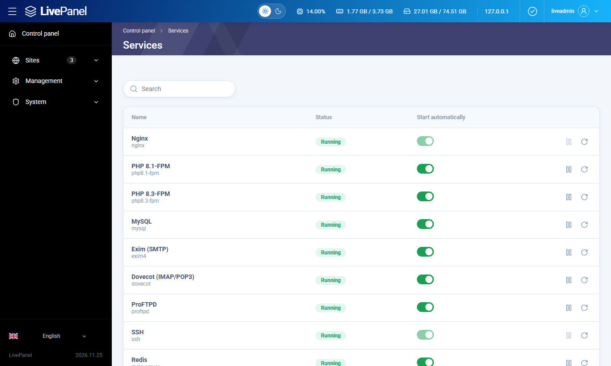

# Системные службы

**Система → Службы** (для администратора) показывает состояние основных служб сервера и позволяет ими управлять.

В списке — Nginx, PHP-FPM (каждая установленная версия), MySQL, PostgreSQL, Exim (SMTP), Dovecot (IMAP/POP3), ProFTPD, SSH, Redis, fail2ban и другие установленные службы. У каждой:

- **состояние** — работает или остановлена;
- переключатель **«Автозапуск»** — запускается ли служба при перезагрузке сервера;
- действия: **«Запустить»**, **«Остановить»**, **«Перезапустить»**.

Некоторые службы поддерживают связь с сервером и не останавливаются: например, SSH можно только перезапустить, а Nginx нужен для работы панели.

## Когда это нужно

- Служба не подхватила изменённую настройку — **«Перезапустить»**.
- Служба не используется (например, почта не нужна) — остановите её и выключите автозапуск, чтобы освободить память.
- Если важная служба остановится, панель напишет администратору — [Обновления и уведомления](updates-notifications.md).

Собственная служба сайта (пул PHP, приложение Node.js/Python) перезапускается в разделе **«Логи»** на странице сайта — [Логи](logs.md).
