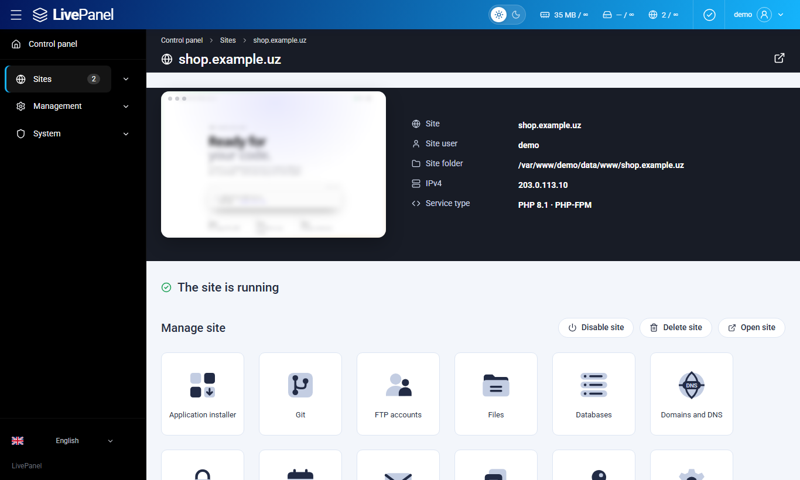

# Управление сайтом

Нажмите на карточку в списке сайтов, чтобы открыть **страницу сайта**. На ней основные сведения о сайте и все его разделы в виде плиток.

## Сведения о сайте

- **Сайт** — домен; значок рядом открывает сайт в новой вкладке.
- **Пользователь сайта** — Linux-пользователь, под которым работает сайт.
- **Папка сайта** — файлы сайта.
- **IPv4** — IP-адрес, на который указывает сайт.
- **Тип службы** — версия и обработчик PHP, Node.js, Python, статика или прокси.
- Состояние: **Сайт работает**, **Сайт работает с ошибками** или **Сайт отключён**.

## Разделы сайта

| Плитка | Статья |
|---|---|
| Установка приложений | [Установка CMS и фреймворков](app-installer.md) |
| Git | [Деплой из Git](git-deploy.md) |
| FTP-аккаунты | [FTP, SFTP и SSH](ftp-ssh.md) |
| Файлы | [Файловый менеджер](file-manager.md) |
| Базы данных | [Базы данных](databases.md) |
| Домены и DNS | [Домены и DNS](dns.md) |
| SSL-сертификаты | [SSL-сертификаты](ssl.md) |
| Планировщик | [Планировщик (cron)](cron.md) |
| Почта | [Почта](mail.md) |
| Резервные копии | [Резервные копии](backups.md) |
| Доступ к сайту, Сканирование | [Безопасность и сканирование сайта](site-security.md) |
| Настройки | [Настройки сайта](site-settings.md) |
| Статистика | [Статистика и трафик](statistics.md) |
| Логи | [Логи](logs.md) |
| Новый поддомен | Открывает мастер для создания поддомена с пользователем этого сайта |

Плитки зависят от прав аккаунта: например, без права «Управление файлами» плитка «Файлы» не показывается.

## Отключение и включение сайта

**«Отключить сайт»** временно останавливает сайт: посетители видят «Сайт отключён» (403), служба Node.js/Python останавливается. Файлы, базы и настройки сохраняются. **«Включить сайт»** возвращает сайт.

## Удаление сайта

**«Удалить сайт»** полностью удаляет сайт:
- файлы сайта, конфигурацию Nginx и PHP/Node/Python и логи;
- базы данных и настройки Git сайта;
- Linux-пользователя тоже, если у него нет других сайтов.

Удаление подтверждается кодом из диалога. **Отменить это нельзя** — сначала сделайте [резервную копию](backups.md).
