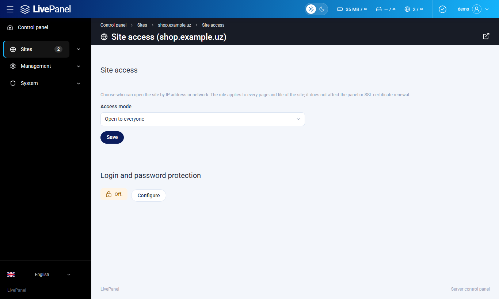
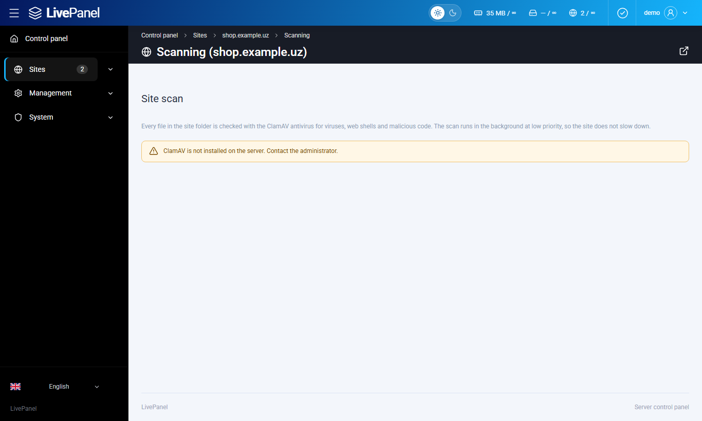

# Безопасность и сканирование сайта

## Доступ к сайту (по IP)

Плитка **«Доступ к сайту»** на странице сайта определяет, кто может открыть сайт, по IP-адресу или сети. Правило действует на все страницы и файлы сайта; на панель и продление SSL-сертификата не влияет.

**Режим доступа:**

- **Открыт для всех** — по умолчанию.
- **Разрешить только адреса из списка** — для офиса или серверов разработки. Все, кого нет в списке, увидят «403 Forbidden» — не забудьте добавить свой IP-адрес.
- **Заблокировать адреса из списка** — для назойливых ботов и атакующих.

В список пишется по одному IP (`203.0.113.7`) или сети (`198.51.100.0/24`) на строку; IPv6 тоже можно.

> Если сайт работает через прокси вроде Cloudflare, Nginx видит адрес прокси, а не посетителя — правило не сработает как ожидается.

На этой же странице видно, включена ли **защита логином и паролем**; **«Настроить»** открывает её в настройках сайта ([Настройки сайта](site-settings.md) → HTTP-авторизация).

## Сканирование (антивирус)

Плитка **«Сканирование»** проверяет все файлы в папке сайта антивирусом **ClamAV** на вирусы, веб-шеллы и вредоносный код. Сканирование идёт в фоне с низким приоритетом — сайт не замедляется.

ClamAV должен быть установлен на сервере: администратор устанавливает его в **Система → Приложения** → `clamav`. База вирусов ~300 МБ, при сканировании используется ~1 ГБ RAM.

1. Нажмите **«Сканировать»**. В зависимости от размера сайта это занимает несколько минут.
2. Результат: **«Угроз не найдено»** или **«Найдено подозрительных файлов: N»** — с путём к файлу и названием угрозы.
3. Для каждого найденного файла:
   - **«Карантин»** — файл убирается из сайта и больше не выполняется; при ложном срабатывании его можно **«Восстановить»**;
   - **«Удалить навсегда»**.

Если сайт взломан: удалите вредоносные файлы, обновите CMS и плагины, смените все пароли (панель, FTP, база, администратор CMS).

## Другая защита

- Лимит частоты запросов к сайту — [Настройки сайта](site-settings.md) → Безопасность.
- Файрвол на уровне сервера — [Файрвол](firewall.md).
- Защита панели, SSH, FTP и почты от подбора паролей — [Настройки и безопасность панели](panel-settings.md).
