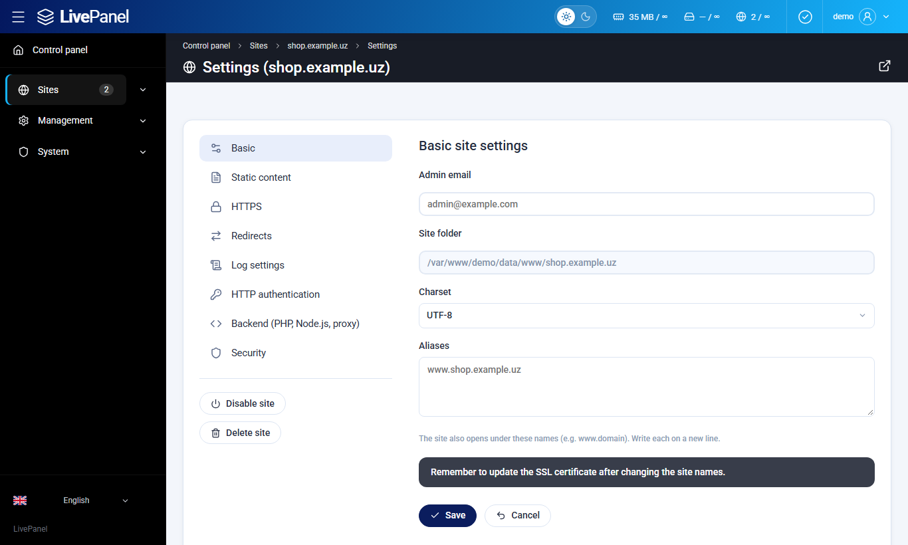
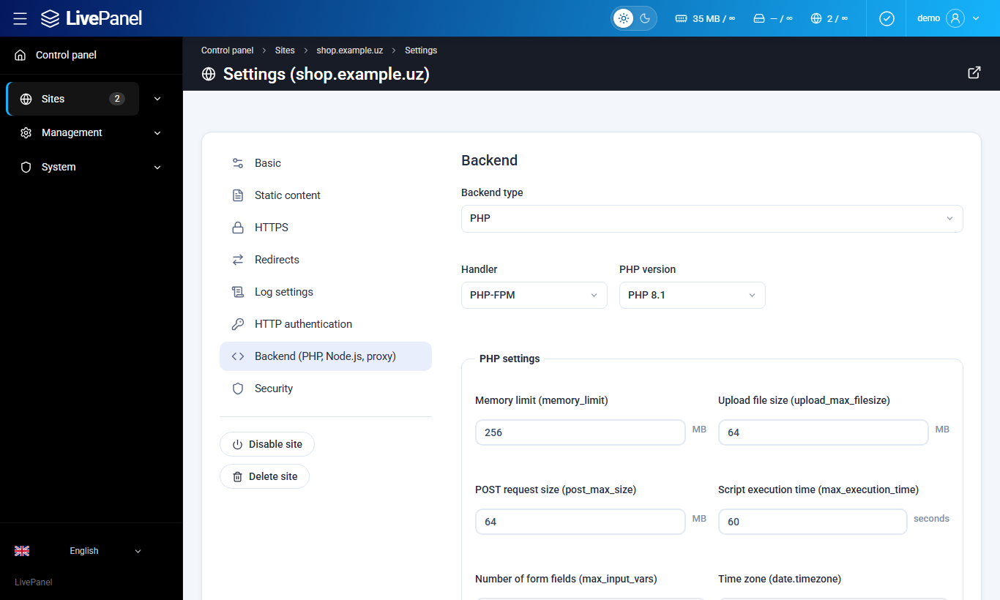

# Настройки сайта

Плитка **«Настройки»** на странице сайта открывает настройки Nginx, бэкенда и безопасности сайта: разделы слева, их поля справа. Изменения применяются кнопкой **«Сохранить»**: панель сначала проверяет конфигурацию Nginx и при ошибке возвращает прежнее состояние — сайт не падает.

## Основное

- **Email администратора** — email администратора сайта (показывается на некоторых страницах ошибок).
- **Папка сайта** — где лежат файлы сайта.
- **Кодировка** — кодировка, которую отдаёт Nginx, обычно UTF-8.
- **Псевдонимы** — другие имена, по которым открывается сайт (например `www.example.uz`), по одному на строку. После изменения перевыпустите SSL-сертификат.

## Статический контент

- **Включить сжатие gzip** и **Уровень gzip** — сжатие страниц; рекомендуется уровень 5.
- **Отдавать статику через Nginx** — картинки, CSS и JS отдаёт Nginx, без обращения к PHP или приложению (быстрее).
- **Расширения статических файлов** и **Срок кэширования (дней)** — сколько браузеры хранят эти файлы.

## HTTPS

- **Перенаправлять на HTTPS** — все HTTP-запросы уходят на HTTPS.
- **Включить HSTS** — браузеры будут открывать сайт только по HTTPS.
- **Включить HTTP/2**.

Для этого сначала нужен SSL-сертификат — [SSL-сертификаты](ssl.md).

## Перенаправления

Отправка посетителей с указанного адреса на другой: **Откуда**, **Куда** и **Код** (301 — постоянное, 302 — временное). Например `/old-page` → `/new-page`.

## Настройки логов

Включение и выключение **журнала доступа** и **журнала ошибок**. Если журнал доступа выключен, трафик и статистика посещений не считаются — [Статистика и трафик](statistics.md).

## HTTP-авторизация

**Защитить сайт логином и паролем** — браузер запросит их при открытии сайта. Удобно для тестовых и внутренних сайтов.

## Бэкенд

**Тип бэкенда** — на чём работает сайт: PHP, Node.js, Python, статический сайт или обратный прокси. Тип можно сменить без пересоздания сайта:

- файлы сайта остаются;
- сначала настраивается и запускается новый бэкенд, затем останавливается старая служба (пул PHP или служба приложения);
- при отсутствии создаётся стартовый `app.js` (Node.js) или `app.py` и `gunicorn.conf.py` (Python);
- если какой-то шаг не удался, сайт остаётся на прежнем бэкенде.

Поля по типам:

- **PHP** — обработчик (PHP-FPM, FastCGI, модуль Apache, CGI), версия PHP и **настройки PHP**: `memory_limit`, `upload_max_filesize`, `post_max_size`, `max_execution_time`, `max_input_vars`, часовой пояс, `display_errors`.
- **Node.js** — версия Node.js и **переменные окружения**.
- **Python** — версия Python и переменные окружения. При смене версии `.venv` создаётся заново — [Сайты на Python и Node.js](python-nodejs.md).
- **Обратный прокси** — адрес, куда передаются запросы, например `http://127.0.0.1:3000`.

| Обработчик PHP | Что это |
|---|---|
| PHP-FPM | Отдельный пул для каждого сайта от имени владельца сайта. Лучший выбор в большинстве случаев |
| FastCGI | Отдельный процесс php-cgi для сайта |
| Модуль Apache | Apache mod_php (mpm-itk), работает `.htaccess`. Только системная версия PHP |
| CGI | php-cgi запускается на каждый запрос. Медленнее, для старых приложений |

## Безопасность

- **Лимит частоты запросов** — сколько запросов в секунду или минуту может делать один IP (защита от флуда и ботов).
- **Всплеск** — разрешить короткие всплески и обслуживать их без задержки.

Ограничение доступа по IP — [Безопасность и сканирование сайта](site-security.md).

## Скорость (Pro)

- **Кеш страниц** — Nginx хранит готовые PHP-страницы и отдаёт их без запуска PHP. **Хранить страницу (минут)** задаёт срок. Вошедшие пользователи, корзина и оформление заказа, админ-страницы, формы (POST) и адреса с параметрами никогда не кешируются. В WordPress кеш очищается сам при изменении контента; есть и кнопка **Очистить кеш**. Только для PHP-сайтов с обработчиком PHP-FPM или FastCGI.
- **Изображения WebP и AVIF** — рядом с JPEG/PNG создаются копии WebP и AVIF и отдаются браузерам, которые их поддерживают; оригиналы не меняются. Новые изображения обрабатываются каждые 10 минут. При выключении копии удаляются.
- **Redis для этого сайта** — отдельный Redis сайта, к которому подключается только пользователь сайта через сокет. Показываются **Лимит памяти (МБ)**, занятая память, кнопка **Очистить Redis** и готовые строки для WordPress (wp-config.php) и Laravel (.env).

## Защита

- **Режим атаки (Premium)** — каждый посетитель сначала проходит короткую проверку браузера (около 2 секунд, раз в 12 часов); боты без JavaScript не попадают на сайт. Включайте только во время атаки: поисковики, API, платёжные callback’и и вебхуки тоже не пройдут проверку.
- **Блокировка по странам (Pro)** — **Только выбранные страны** или **Все, кроме выбранных**; остальные получают «403 Forbidden». Данные о странах — бесплатная база DB-IP (обновляется ежемесячно).

## Обслуживание

**Режим обслуживания** — посетители видят страницу «На сайте ведутся технические работы» (с кодом 503, поэтому поисковики не убирают сайт из индекса). Заголовок и текст страницы вы пишете сами. IP из списка **Адреса, которые видят сайт** видят сайт как обычно; ваш адрес добавляется сам при включении режима. Обновление SSL-сертификата не блокируется.

**Защита от хотлинка** (в разделе «Защита») — другие сайты не смогут показывать изображения и видео этого сайта на своих страницах. Поисковики, прямое открытие и домены из списка (с поддоменами) работают.
